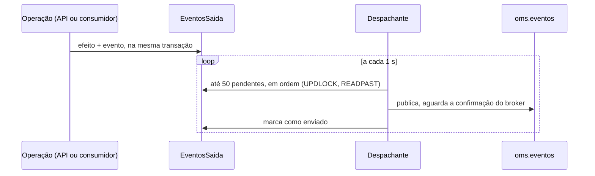

# Fluxo 8: publicação de eventos e consumo

**Onde roda**: Worker. O despachante do outbox publica, e a base de consumo entrega os eventos
a cada consumidor.
**Origem**: REQ-06 ([spec](../../specs/006-mensageria/spec.md),
[topologia e consumo](../../specs/006-mensageria/contracts/topologia-e-consumo.md),
[schemas](../../specs/006-mensageria/contracts/eventos/)), REQ-12 ([spec](../../specs/012-publicacao-garantida/spec.md),
[contrato](../../specs/012-publicacao-garantida/contracts/publicacao-e-reconciliacao.md)), REQ-14
([spec](../../specs/014-limpeza-e-dlq/spec.md), mensagem reenviada da DLQ) e REQ-15
([spec](../../specs/015-visibilidade-cancelamentos/spec.md), [contrato e schemas](../../specs/015-visibilidade-cancelamentos/contracts/eventos-cancelamento-e-estorno.md) de `pedido.cancelado` e `pagamento.estornado`).

## Eventos

| Tipo | Gravado por | Consumidor interno |
|------|-------------|--------------------|
| `pedido.criado` | criação do pedido (API) | `estoque` |
| `estoque.reservado` | `estoque` | `pagamento` |
| `estoque.insuficiente` | `estoque` | nenhum |
| `pagamento.aprovado` | `pagamento` | `entrega` |
| `pagamento.recusado` | `pagamento` | nenhum |
| `entrega.criada` | `entrega` | nenhum |
| `pedido.cancelado` | todo cancelamento: API, `estoque`, reconciliação (REQ-15) | nenhum |
| `pagamento.estornado` | confirmação do estorno no Worker (REQ-15) | nenhum |

Todos usam o mesmo envelope:

```json
{ "idEvento": "0199f1a2-7b3c-…", "tipo": "pedido.criado", "versao": 1,
  "ocorridoEm": "2026-10-24T15:00:00.123Z", "idCorrelacao": "<id do pedido>", "dados": { … } }
```

Os contratos são versionados (Princípio II): na mesma versão, só entram campos opcionais.

### Sistemas de fora: cancelamentos e estornos (REQ-15)

Um sistema de fora (financeiro, atendimento, logística) recebe os cancelamentos e os estornos
ligando a própria fila à troca `oms.eventos` (`topic`) com as chaves `pedido.cancelado` e
`pagamento.estornado`. Nenhum consumidor interno os recebe.

- `pedido.cancelado` sai em **toda** chegada de um pedido a `Cancelado`: pela API (`Cliente` ou
  `Operacao`), pela falta de estoque (`EstoqueInsuficiente`, junto com o `estoque.insuficiente`)
  e pela reconciliação (`ReconciliacaoEsgotada`, com a etapa). Não sai para `PagamentoRejeitado`,
  que continua avisado só pelo `pagamento.recusado`.
- `pagamento.estornado` sai uma vez por pedido, quando o Worker confirma o estorno (fluxo 10).
- Sem dados pessoais, sem o identificador do Cliente e sem o motivo digitado na API. O
  `pagamento.estornado` traz os identificadores do gateway, como o `pagamento.aprovado`.
- **Nenhum caminho esquece o evento**: a gravação do pedido recusa, com erro, um pedido que vai
  a `Cancelado` sem `pedido.cancelado`, ou um pagamento que vai a `Estornado` sem
  `pagamento.estornado`, na mesma gravação (REQ-15, R-03). Nada é gravado, e o erro segue o
  caminho de quem chamou: na API, 500; no Worker, novas tentativas e DLQ.
- Não há ordem garantida entre tipos diferentes, nem entre o `estoque.insuficiente` e o
  `pedido.cancelado` da mesma gravação. Deduplicar por `idEvento`.

## Publicação: o outbox



- **Por quê**: o efeito e o evento são gravados juntos, então nunca há pedido sem evento nem
  evento sem pedido. A API não depende do broker.
- **Ordem**: os eventos saem na ordem de gravação. Se um falha, o lote para, e os seguintes
  esperam atrás dele.
- **Várias instâncias**: cada Worker pega linhas próprias (`READPAST`), sem publicar o mesmo
  evento ao mesmo tempo.
- **Garantia**: pelo menos uma vez. Uma queda entre a confirmação do broker e o commit
  republica o evento, e o consumidor descarta o duplicado.

### Publicação garantida (REQ-12)

- **Filas antes de publicar.** A cada canal novo (na partida, depois de uma reconexão ou
  depois de uma falha), o despachante declara as filas de todos os consumidores conhecidos:
  principal, espera e DLQ. Ele usa a mesma função e as mesmas opções que os consumidores,
  então a declaração dos dois lados nunca entra em conflito.
- **Rota obrigatória.** Os tipos com consumidor interno saem com `mandatory`. Os demais
  (`estoque.insuficiente`, `pagamento.recusado`, `entrega.criada`, `pedido.cancelado` e
  `pagamento.estornado`) saem sem exigir fila, para sistemas externos que declaram as próprias.

| Situação | Resultado | Por quê |
|----------|-----------|---------|
| Broker confirma | Marcado como enviado (log 5001) | — |
| Broker devolve sem rota (fila do consumidor apagada) | Continua pendente, com `UltimoErro = "SemRota: NO_ROUTE"` e log 5002 com o motivo `SemRota`. O canal é descartado, e o canal novo recria a fila. O evento sai na tentativa seguinte | Antes do REQ-12, o evento era descartado em silêncio e o pedido ficava parado para sempre |
| Broker não confirma (nack, canal quebrado, sem resposta em 5 s) | Continua pendente, com o erro gravado | Nunca é marcado como enviado sem confirmação |
| Tipo sem consumidor e sem nenhuma fila ligada | Marcado como enviado | Não há consumidor interno a esperar |

A espera entre tentativas de um evento cresce em 2^n segundos, com teto de 10 s.

## Consumo: a base

Cada consumidor `C` tem a fila `oms.C`, as filas de espera `oms.C.espera.{1000,2000,4000}` e
a DLQ `oms.C.dlq`.

| Situação | Resultado | Por quê |
|----------|-----------|---------|
| Manipulador termina sem exceção | O efeito e o registro de processado são gravados na mesma transação; depois, o ack | O ack só vem depois do commit |
| Evento já processado por este consumidor | Ack sem chamar o manipulador (log 5005) | Descarte de duplicados, por consumidor |
| Exceção, até a terceira vez | Vai para a fila de espera do próximo intervalo (1 s, 2 s, 4 s) e volta sozinho; log 5003 | Falhas passageiras não bloqueiam a fila |
| Exceção na quarta execução | Vai para a DLQ, com os cabeçalhos `x-tentativas`, `x-ultimo-erro`, `x-motivo` e `x-falhou-em`; log 5004 | Uma falha permanente não fica em loop |
| Corpo inválido, tipo ou versão desconhecidos, campo obrigatório ausente | Direto para a DLQ, sem tentativa | Repetir não corrige a mensagem |

Exemplo: o banco cai enquanto o consumidor de estoque processa um `pedido.criado`. O evento
é tentado de novo após 1 s, 2 s e 4 s. Se o banco ainda não voltou, a mensagem vai para
`oms.estoque.dlq`, e o pedido fica `Pendente` sem reserva até a reconciliação (fluxo 9).

### Mensagem reenviada da DLQ (REQ-14)

Um Admin pede o reenvio pela API, e o Worker devolve a mensagem para `oms.C` (fluxo 11). Ela
chega como uma entrega nova:

| Cabeçalho | Na cópia reenviada |
|-----------|--------------------|
| `x-tentativas`, `x-ultimo-erro` | Removidos: as tentativas recomeçam do zero |
| `x-reenvios` | Anterior + 1; a base de consumo o copia ao mandar para a espera e para a DLQ |
| `x-reenviado-em`, `x-pedido-reenvio` | Instante e identificador do pedido de reenvio |
| `x-motivo`, `x-falhou-em` | Mantidos até a próxima falha, que os sobrescreve |

O `MessageId` e o envelope não mudam, então um evento já processado é descartado como
duplicado (5005), sem efeito repetido.

## Falhas externas

| Falha | Comportamento |
|-------|---------------|
| Broker fora do ar na partida do Worker | O Worker sobe. A prontidão mostra o broker indisponível; consumidores e despachante tentam de novo até conectar (log 5008) |
| Broker fora do ar por muito tempo | Os eventos se acumulam no outbox, sem limite. A espera de cada um cresce até 10 s |
| Broker recriado (filas apagadas) | O canal novo do despachante recria as filas antes de publicar |
| Fila de um consumidor apagada com o Worker no ar | O despachante a recria, mas o consumidor dela perde a inscrição até o Worker reiniciar. A mensagem fica na fila, e a reconciliação leva o pedido adiante |
| Credenciais do broker inválidas | O Worker não fica pronto, e a prontidão não revela as credenciais |
| Banco fora do ar | O ciclo de despacho falha (log 5007) e é tentado no seguinte; o consumo segue as novas tentativas e a DLQ |
| Worker cai entre o efeito e o ack | A reentrega é descartada como duplicada (efeito e registro estão na mesma transação) |

## Configuração (seção `Mensageria`)

| Chave | Padrão |
|-------|--------|
| `IntervaloDespachoMs` | 1000 |
| `TamanhoLote` | 50 |
| `IntervalosNovaTentativaMs` | 1000, 2000, 4000 |
| `PrefetchConsumidor` | 10 |

## Telemetria (REQ-16)

Com a telemetria ligada, cada evento do outbox guarda o contexto de quem o gravou (coluna
`ContextoRastreio`), e o despachante publica dentro de `outbox publicar {tipo}`, filho desse
contexto, com `oms.outbox.espera_ms`. O RabbitMQ.Client grava o cabeçalho de transporte
`traceparent` na publicação, e o span `deliver` do consumidor continua o trace, marcado com
`oms.consumidor`, `oms.evento.tipo`, `oms.pedido.id`, `oms.tentativa` e `oms.resultado`
(`processado`, `duplicado`, `nova_tentativa`, `dlq`, `irrecuperavel`). A métrica
`oms.mensageria.mensagens` conta os mesmos resultados por consumidor, e
`oms.outbox.eventos_pendentes` e `oms.outbox.pendente_mais_antigo.idade` mostram um despachante
parado. O envelope v1 não muda. Desligada, nada disso acontece. Detalhes no
[fluxo 12](12-rastreabilidade-e-metricas.md).

## Limpeza e reenvio (REQ-14)

Os eventos enviados e os registros de processados são apagados pela limpeza depois de 7 dias,
e a DLQ é reenviada pelo pedido de um Admin, sem o painel do broker (#30). Os detalhes estão
no [fluxo 11](11-limpeza-e-reenvio-da-dlq.md).

## Limitações

- A purga da DLQ (apagar mensagens sem reenviar) continua manual, pelo painel do RabbitMQ.
- Um tipo sem consumidor interno (por exemplo, `pedido.cancelado`) publicado sem nenhuma fila
  ligada é descartado pelo broker e dado como enviado. Um sistema de fora só recebe o que for
  publicado depois de ligar a própria fila (REQ-15, Assumptions).
