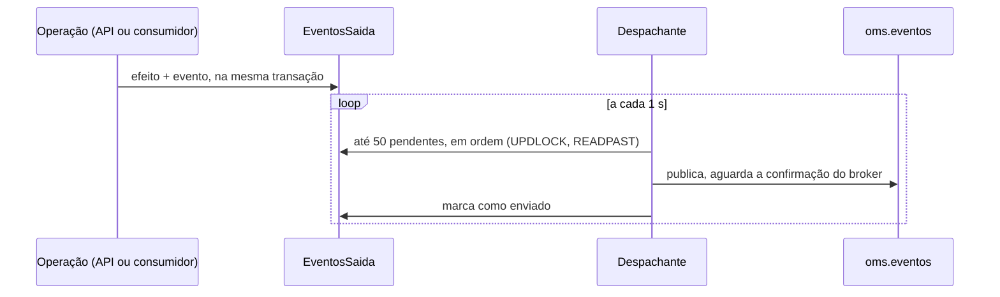

# Fluxo 8: publicação de eventos e consumo

**Onde roda**: Worker. O despachante do outbox publica, e a base de consumo entrega os eventos
a cada consumidor.
**Origem**: REQ-06 ([spec](../../specs/006-mensageria/spec.md),
[topologia e consumo](../../specs/006-mensageria/contracts/topologia-e-consumo.md),
[schemas](../../specs/006-mensageria/contracts/eventos/)) e REQ-12 ([spec](../../specs/012-publicacao-garantida/spec.md),
[contrato](../../specs/012-publicacao-garantida/contracts/publicacao-e-reconciliacao.md)).

## Eventos

| Tipo | Gravado por | Consumidor interno |
|------|-------------|--------------------|
| `pedido.criado` | criação do pedido (API) | `estoque` |
| `estoque.reservado` | `estoque` | `pagamento` |
| `estoque.insuficiente` | `estoque` | nenhum |
| `pagamento.aprovado` | `pagamento` | `entrega` |
| `pagamento.recusado` | `pagamento` | nenhum |
| `entrega.criada` | `entrega` | nenhum |

Todos usam o mesmo envelope:

```json
{ "idEvento": "0199f1a2-7b3c-…", "tipo": "pedido.criado", "versao": 1,
  "ocorridoEm": "2026-10-24T15:00:00.123Z", "idCorrelacao": "<id do pedido>", "dados": { … } }
```

Os contratos são versionados (Princípio II): na mesma versão, só entram campos opcionais.

## Publicação: o outbox



- **Por quê**: o efeito e o evento são gravados juntos, então nunca há pedido sem evento nem
  evento sem pedido. A API não depende do broker.
- **Ordem**: os eventos saem na ordem de gravação. Se um falha, o lote para, e os seguintes
  esperam atrás dele.
- **Várias instâncias**: cada Worker pega linhas próprias (`READPAST`), sem publicar o mesmo
  evento ao mesmo tempo.
- **Garantia**: pelo menos uma vez. Uma queda entre a confirmação do broker e o commit
  republica o evento, e o consumidor descarta o duplicado.

### Publicação garantida (REQ-12)

- **Filas antes de publicar.** A cada canal novo (na partida, depois de uma reconexão ou
  depois de uma falha), o despachante declara as filas de todos os consumidores conhecidos:
  principal, espera e DLQ. Ele usa a mesma função e as mesmas opções que os consumidores,
  então a declaração dos dois lados nunca entra em conflito.
- **Rota obrigatória.** Os tipos com consumidor interno saem com `mandatory`. Os demais
  (`estoque.insuficiente`, `pagamento.recusado`, `entrega.criada`) saem sem exigir fila, para
  sistemas externos que declaram as próprias.

| Situação | Resultado | Por quê |
|----------|-----------|---------|
| Broker confirma | Marcado como enviado (log 5001) | — |
| Broker devolve sem rota (fila do consumidor apagada) | Continua pendente, com `UltimoErro = "SemRota: NO_ROUTE"` e log 5002 com o motivo `SemRota`. O canal é descartado, e o canal novo recria a fila. O evento sai na tentativa seguinte | Antes do REQ-12, o evento era descartado em silêncio e o pedido ficava parado para sempre |
| Broker não confirma (nack, canal quebrado, sem resposta em 5 s) | Continua pendente, com o erro gravado | Nunca é marcado como enviado sem confirmação |
| Tipo sem consumidor e sem nenhuma fila ligada | Marcado como enviado | Não há consumidor interno a esperar |

A espera entre tentativas de um evento cresce em 2^n segundos, com teto de 10 s.

## Consumo: a base

Cada consumidor `C` tem a fila `oms.C`, as filas de espera `oms.C.espera.{1000,2000,4000}` e
a DLQ `oms.C.dlq`.

| Situação | Resultado | Por quê |
|----------|-----------|---------|
| Manipulador termina sem exceção | O efeito e o registro de processado são gravados na mesma transação; depois, o ack | O ack só vem depois do commit |
| Evento já processado por este consumidor | Ack sem chamar o manipulador (log 5005) | Descarte de duplicados, por consumidor |
| Exceção, até a terceira vez | Vai para a fila de espera do próximo intervalo (1 s, 2 s, 4 s) e volta sozinho; log 5003 | Falhas passageiras não bloqueiam a fila |
| Exceção na quarta execução | Vai para a DLQ, com os cabeçalhos `x-tentativas`, `x-ultimo-erro`, `x-motivo` e `x-falhou-em`; log 5004 | Uma falha permanente não fica em loop |
| Corpo inválido, tipo ou versão desconhecidos, campo obrigatório ausente | Direto para a DLQ, sem tentativa | Repetir não corrige a mensagem |

Exemplo: o banco cai enquanto o consumidor de estoque processa um `pedido.criado`. O evento
é tentado de novo após 1 s, 2 s e 4 s. Se o banco ainda não voltou, a mensagem vai para
`oms.estoque.dlq`, e o pedido fica `Pendente` sem reserva até a reconciliação (fluxo 9).

## Falhas externas

| Falha | Comportamento |
|-------|---------------|
| Broker fora do ar na partida do Worker | O Worker sobe. A prontidão mostra o broker indisponível; consumidores e despachante tentam de novo até conectar (log 5008) |
| Broker fora do ar por muito tempo | Os eventos se acumulam no outbox, sem limite. A espera de cada um cresce até 10 s |
| Broker recriado (filas apagadas) | O canal novo do despachante recria as filas antes de publicar |
| Fila de um consumidor apagada com o Worker no ar | O despachante a recria, mas o consumidor dela perde a inscrição até o Worker reiniciar. A mensagem fica na fila, e a reconciliação leva o pedido adiante |
| Credenciais do broker inválidas | O Worker não fica pronto, e a prontidão não revela as credenciais |
| Banco fora do ar | O ciclo de despacho falha (log 5007) e é tentado no seguinte; o consumo segue as novas tentativas e a DLQ |
| Worker cai entre o efeito e o ack | A reentrega é descartada como duplicada (efeito e registro estão na mesma transação) |

## Configuração (seção `Mensageria`)

| Chave | Padrão |
|-------|--------|
| `IntervaloDespachoMs` | 1000 |
| `TamanhoLote` | 50 |
| `IntervalosNovaTentativaMs` | 1000, 2000, 4000 |
| `PrefetchConsumidor` | 10 |

## Limitações

- A DLQ é inspecionada e reenviada à mão, pelo painel do RabbitMQ (#30). Uma mensagem
  reenviada volta como evento novo para as tentativas, e o descarte de duplicados evita
  efeito repetido.
- Os eventos enviados e os registros de processados não são apagados (#30).
