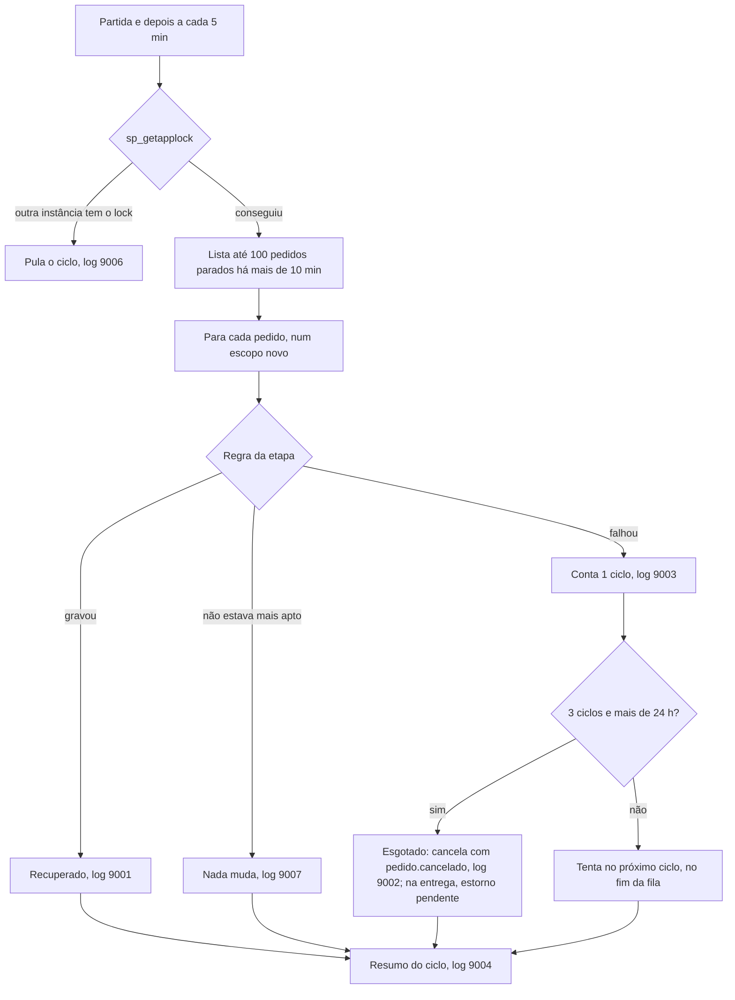

# Fluxo 9: reconciliação de pedidos parados

**Onde roda**: Worker, serviço `ReconciliadorPedidos`, periódico e automático.
**Origem**: REQ-12 ([spec](../../specs/012-publicacao-garantida/spec.md),
[contrato](../../specs/012-publicacao-garantida/contracts/publicacao-e-reconciliacao.md),
[research](../../specs/012-publicacao-garantida/research.md)), REQ-13
([spec](../../specs/013-cancelamento-com-estorno/spec.md), esgotamento da etapa de entrega) e REQ-15
([spec](../../specs/015-visibilidade-cancelamentos/spec.md), `pedido.cancelado` no esgotamento).

## Para que serve

Um pedido pode parar no meio do fluxo automático porque o evento que o levaria adiante se
perdeu: foi para a DLQ, foi descartado antes do REQ-12, ou ficou numa fila sem leitor. A
reconciliação parte do **estado do pedido**, não dos eventos antigos, e aplica a mesma regra
do consumidor da etapa, com o mesmo resultado e o mesmo evento de saída.

**Por quê pelo estado**: republicar os eventos antigos do outbox foi rejeitado no REQ-10. Eles
podem ter sido apagados pela limpeza futura e iriam para todas as filas, não só para a que
faltou.

## Caminho feliz



| Etapa | Pedido parado | Regra aplicada (a do consumidor) |
|-------|---------------|----------------------------------|
| Estoque | status não final, sem reserva | reserva ou cancelamento por falta (fluxo 4) |
| Pagamento | `AptoParaPagamento` | cobrança, aprovada ou recusada (fluxo 5) |
| Entrega | `AptoParaOrdemEntrega` | ordem de entrega (fluxo 6) |

Exemplo: um pedido foi pago antes de a fila `oms.entrega` existir e ficou em `Processando` sem
ordem. Na partida do Worker, o primeiro ciclo cria a ordem, leva o pedido a `ProntoParaEnvio`,
grava o `entrega.criada` e escreve:

```text
warn: ServicoReconciliacao[9001] Pedido 01a16b66-… parado na etapa Entrega recuperado pela reconciliação.
warn: ReconciliadorPedidos[9004] Reconciliação: recuperados 0 no estoque, 0 no pagamento e 1 na entrega; 0 esgotado(s) e 0 falha(s).
```

## Resultados possíveis

| Situação | Resultado | Por quê |
|----------|-----------|---------|
| Pedido atualizado há menos de 10 min | Não é candidato | O fluxo normal ainda pode estar a caminho |
| A regra gravou o efeito | Recuperado | — |
| A regra encontrou o pedido não apto | Nada muda | Outro caminho já o moveu |
| A regra lançou exceção (gateway fora, banco fora, conflitos persistentes) | Conta um ciclo com falha, em memória; nada é gravado no pedido | Decisão do clarify: não gravar marcas de falha no pedido |
| Recusa do gateway | **Não** é falha: é o resultado normal (`PagamentoRejeitado`) | — |
| Estoque: 3 ciclos com falha e parado há mais de 24 h | `Cancelado`, sem autor, "Não foi possível reservar o estoque.", e `pedido.cancelado` com a etapa `Estoque` | Um pedido não fica parado para sempre |
| Pagamento: 3 ciclos com falha e parado há mais de 24 h | Pagamento `NaoProcessado`, estoque devolvido e `Cancelado`, sem autor, "Não foi possível processar o pagamento.", e `pedido.cancelado` com a etapa `Pagamento` | Libera o estoque preso |
| Entrega: 3 ciclos com falha e parado há mais de 24 h | Estoque devolvido, pagamento `EstornoPendente` e `Cancelado`, sem autor, "Não foi possível criar a ordem de entrega.", e `pedido.cancelado` com a etapa `Entrega`; o Worker estorna depois (fluxo 10), logs 9002 e 7005 (origem `Reconciliacao`) | O pedido está pago: cancelar exige o estorno, que o REQ-13 trouxe (#28) |
| Mais de 24 h, mas só 1 ou 2 ciclos com falha | Não é cancelado | Uma falha isolada num pedido antigo não basta |
| Pedido saiu da etapa entre a falha e o esgotamento | Não é cancelado | O esgotamento relê o pedido e confere a etapa antes de cancelar |

A regra sempre é tentada antes do esgotamento: um pedido que voltaria a funcionar nunca é
cancelado sem uma última tentativa.

## Idempotência e concorrência

| Caso | Resultado | Por quê |
|------|-----------|---------|
| Dois Workers ao mesmo tempo | Só um reconcilia por ciclo; o outro pula (log 9006) | `sp_getapplock 'oms-reconciliacao'`, liberado com `sp_releaseapplock` no fim do ciclo. Sem o lock, o gateway seria chamado duas vezes |
| Reconciliação e consumidor sobre o mesmo pedido | Um efeito só | A mesma concorrência otimista e as mesmas 3 reavaliações do consumidor |
| O evento original chega depois da recuperação | O consumidor o ignora (pedido não apto) | — |
| Ciclos repetidos sobre o mesmo pedido | Um efeito só | A regra relê e decide pelo domínio |
| Lote cheio de pedidos que falham sempre | Os pedidos que já falharam vão para o fim do lote; um pedido parado novo é tratado no ciclo seguinte | Evita que falhas permanentes travem a fila |
| Worker reiniciado | A contagem de falhas recomeça | Fica em memória: o esgotamento é só adiado, nunca antecipado |
| Esgotamento da entrega e cancelamento pela API ao mesmo tempo | Um dos dois vence; o pedido é cancelado uma vez, com um único estorno pendente | Concorrência otimista; o esgotamento relê o pedido e confere a etapa antes de cancelar |

## Falhas externas

| Falha | Comportamento |
|-------|---------------|
| Banco fora do ar | O ciclo termina com o log 9005 e é tentado no próximo intervalo, sem derrubar o Worker |
| Broker fora do ar | Não afeta: a reconciliação só grava no banco. Os eventos de saída esperam no outbox |
| Gateway fora do ar | Falha do pedido na etapa de pagamento; contagem e esgotamento como acima. O esgotamento da entrega não chama o gateway: o pedido é cancelado e só o estorno espera |

## Configuração (seção `Reconciliacao`, validada na partida)

| Chave | Padrão | Faixa |
|-------|--------|-------|
| `Habilitada` | `true` | — |
| `IntervaloCicloSegundos` | 300 | 1 a 86 400 |
| `LimiteParadoSegundos` | 600 | 1 a 604 800 |
| `LimiteEsgotamentoSegundos` | 86 400 | maior que o limite parado, até 2 592 000 |
| `CiclosFalhaEsgotamento` | 3 | 1 a 100 |
| `TamanhoLote` | 100 | 1 a 1 000 |

Fora das faixas, o Worker não sobe e a mensagem cita a chave, por exemplo
"Reconciliacao:TamanhoLote deve estar entre 1 e 1000.".

## Observabilidade

| Log | Nível | Quando |
|-----|-------|--------|
| 9001 `PedidoRecuperado` | Warning | Pedido recuperado (id e etapa) |
| 9002 `PedidoEsgotado` | Error | Pedido cancelado por esgotamento (id, etapa, ciclos com falha e motivo) |
| 9003 `FalhaPedidoReconciliacao` | Warning | Falha da regra num pedido (id, etapa, ciclos e erro) |
| 9004 `ResumoReconciliacao` | Warning se recuperou ou esgotou algo; Debug se não | Fim de cada ciclo, com as contagens por etapa |
| 9005 `FalhaCicloReconciliacao` | Warning | Falha do ciclo inteiro |
| 9006 `CicloReconciliacaoIgnorado` | Debug | Outra instância tem o lock |
| 9007 `PedidoNaoMaisParado` | Debug | O pedido já não estava parado |

Os logs trazem só identificadores, etapas e contagens. Um aviso 9001 indica que um evento
se perdeu: vale investigar a causa (DLQ, broker, consumidor parado).

Com a telemetria ligada (REQ-16), cada ciclo que pega o lock é um trace `reconciliar`, e cada
pedido tratado é um passo `reconciliar pedido`, com `oms.pedido.id`, `oms.etapa`,
`oms.resultado` (`recuperado`, `esgotado`, `falhou`) e um link para o trace de criação do
pedido. O evento gravado pelo passo continua o trace dele. A métrica `oms.rotinas.itens`
(`oms.rotina = reconciliacao`) conta os resultados. O ciclo ignorado (9006) não gera trace.
Detalhes no [fluxo 12](12-rastreabilidade-e-metricas.md).

## Limitações

- Nenhuma pendência de visibilidade: o cancelamento por esgotamento sai como `pedido.cancelado`,
  com o motivo `ReconciliacaoEsgotada` e a etapa (#29, REQ-15).
- As situações `NaoProcessado`, `EstornoPendente` e `Estornado` são internas: não aparecem na API.
