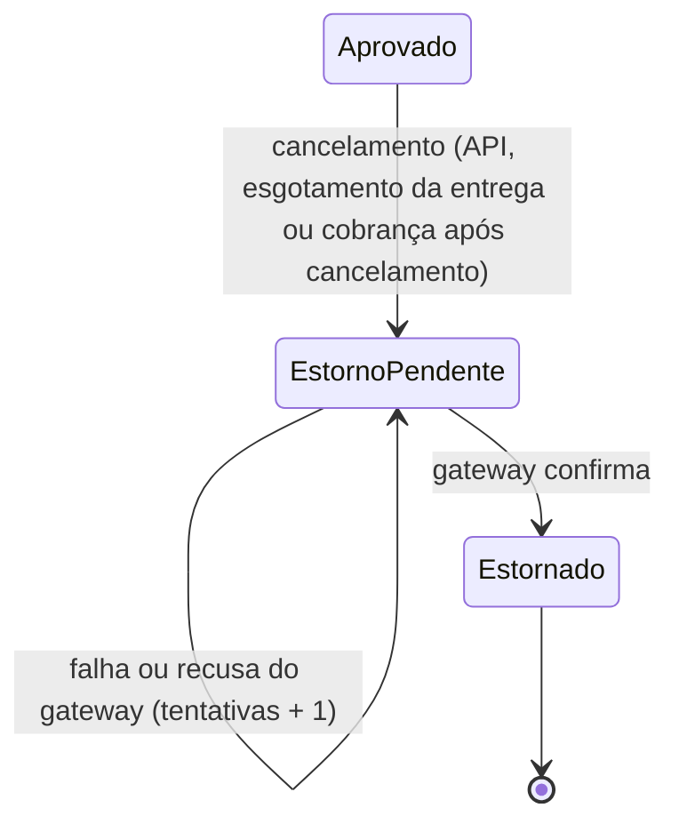
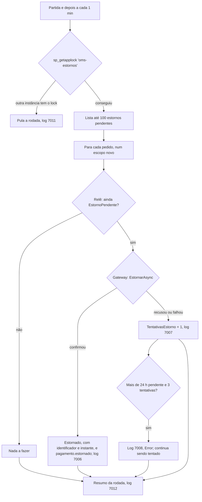

# Fluxo 10: estorno

**Onde roda**: Worker, serviço `ProcessadorEstornos`, periódico e automático. O estorno é pedido
pelo cancelamento (fluxo 3), pelo esgotamento da entrega (fluxo 9) ou pelo consumidor de
pagamento (fluxo 5).
**Origem**: REQ-13 ([spec](../../specs/013-cancelamento-com-estorno/spec.md),
[contrato](../../specs/013-cancelamento-com-estorno/contracts/estorno-e-cancelamento.md),
[research](../../specs/013-cancelamento-com-estorno/research.md)), issue #28, e REQ-15
([spec](../../specs/015-visibilidade-cancelamentos/spec.md), `pagamento.estornado`), issue #29.

## Para que serve

O Cliente nunca fica cobrado por um pedido cancelado. Cancelar um pedido pago deixa o estorno
**pendente** na mesma gravação do cancelamento, e o Worker pede o estorno ao gateway logo
depois, tentando de novo até conseguir.

**Por que assíncrono**: o cancelamento não pode depender do gateway. Com o gateway ou o Worker
fora do ar, a API cancela normalmente e só o estorno espera (decisão do specify do REQ-13;
princípio IV da constituição).

## Situações do pagamento



As duas situações são internas: não aparecem na API nem nos eventos (REQ-13, clarify).

| Quem pede o estorno | Quando | Log 7005, origem |
|---------------------|--------|------------------|
| Cancelamento pela API | Admin ou OperadorLogistica cancela um pedido com pagamento `Aprovado` (fluxo 3) | `Operacao` |
| Reconciliação | Esgotamento da etapa de entrega (fluxo 9) | `Reconciliacao` |
| Consumidor de pagamento | O gateway aprovou a cobrança, mas o pedido foi cancelado antes da gravação (fluxo 5) | `CobrancaAposCancelamento` |

## Caminho feliz



Exemplo: a operação cancela um pedido de 149,70 em `ProntoParaEnvio`. A API responde 200, e o
Worker escreve, na rodada seguinte:

```text
info: ServicoEstornos[7006] Estorno do pedido 0199f1a2-… (valor 149.70) confirmado pelo gateway depois de 0 tentativa(s) com falha.
info: ProcessadorEstornos[7012] Rodada de estornos: 1 confirmado(s) e 0 falha(s).
```

Na mesma gravação da confirmação sai o `pagamento.estornado` (REQ-15), uma única vez por
pedido, com os identificadores do gateway, que continuam fora dos logs:

```json
{ "tipo": "pagamento.estornado", "versao": 1, "idCorrelacao": "0199f1a2-…",
  "dados": { "pedidoId": "0199f1a2-…", "numero": "PED-20261024-000001", "valor": 149.70,
             "identificadorTransacao": "SIM-0199f1a1…", "identificadorEstorno": "SIM-EST-0199f1a3…",
             "estornadoEm": "2026-10-24T15:21:00+00:00" } }
```

A cobrança aprovada para um pedido já cancelado (fluxo 5) não gera `pagamento.aprovado`: o
`pedido.cancelado` desse pedido saiu com `estornoPendente: false`, e o caso aparece só no
`pagamento.estornado`, que traz o valor e a transação da cobrança. Para conciliar dinheiro, a
fonte é o `pagamento.estornado`.

## Ordem da fila

Primeiro os estornos que nunca falharam, do mais antigo para o mais novo; depois os que já
falharam, o tentado há mais tempo primeiro. Assim, um estorno que falha sempre não impede os
novos de saírem (índice filtrado `IX_Pagamentos_EstornoPendente`).

## Resultados possíveis

| Situação | Resultado | Por quê |
|----------|-----------|---------|
| Gateway confirma | `Estornado`, com `IdentificadorEstorno` e `EstornadoEm` | — |
| Gateway recusa (resposta válida, negativa) | Conta como falha: continua `EstornoPendente`, log 7007 com "Recusado: …" | O dinheiro do Cliente precisa voltar; a recusa não encerra o estorno |
| Gateway lança exceção ou não responde | Continua `EstornoPendente`, `TentativasEstorno + 1`, log 7007 | Tenta na próxima rodada |
| Mais de `LimiteAlertaSegundos` desde o pedido de estorno **e** pelo menos `TentativasAlerta` tentativas | Log 7008 (Error) a cada nova falha; continua sendo tentado | Sinal para a operação agir fora do sistema; o estorno **nunca desiste** |
| O estorno já não está pendente quando a rodada o relê | Nada a fazer | Outra instância já confirmou |

## Idempotência e concorrência

| Caso | Resultado | Por quê |
|------|-----------|---------|
| Dois Workers ao mesmo tempo | Um só estorno no gateway; o outro Worker pula a rodada (log 7011) | `sp_getapplock 'oms-estornos'`, liberado com `sp_releaseapplock` no fim da rodada |
| Gateway confirma e o Worker cai antes de gravar | A rodada seguinte pede de novo e recebe **o mesmo estorno** | O pedido é a chave de idempotência do estorno (FR-013) |
| Conflito de concorrência ao gravar a confirmação | Relê e grava de novo, sem chamar o gateway, até 3 vezes; esgotadas, log 7007 sem contar tentativa, e a rodada seguinte recebe o mesmo estorno | O gateway confirmou: não é falha do estorno |
| Conflito ao gravar a falha | A tentativa não é contada; a rodada seguinte trata o pedido de novo | Nada é gravado sobre um estado antigo |
| Dois cancelamentos do mesmo pedido | Um só `EstornoPendente` (o segundo cancelamento responde 409) | Concorrência otimista no pedido |

## Falhas externas

| Falha | Comportamento |
|-------|---------------|
| Gateway fora do ar | Os cancelamentos continuam; os estornos ficam pendentes e são tentados a cada rodada, com 7008 depois de 24 h e 3 tentativas |
| Worker fora do ar | Os cancelamentos continuam pela API; os estornos esperam até o Worker voltar e saem na primeira rodada |
| Banco fora do ar | A rodada termina com o log 7010 e é tentada no próximo intervalo, sem derrubar o Worker. Um erro num pedido também vai para o 7010, com o id do pedido, e os demais seguem |
| Broker fora do ar | Não afeta o estorno: o `pagamento.estornado` fica pendente no outbox e sai quando o broker volta (fluxo 8) |

## Configuração (seção `Estornos`, validada na partida)

| Chave | Padrão | Faixa |
|-------|--------|-------|
| `Habilitado` | `true` | — |
| `IntervaloSegundos` | 60 | 1 a 3 600 |
| `TamanhoLote` | 100 | 1 a 1 000 |
| `LimiteAlertaSegundos` | 86 400 | 1 a 2 592 000 |
| `TentativasAlerta` | 3 | 1 a 100 |

Fora das faixas, o Worker não sobe e a mensagem cita a chave, por exemplo
"Estornos:TamanhoLote deve estar entre 1 e 1000.". Os testes de integração desligam o
processador por padrão.

## Observabilidade

| Log | Nível | Quando |
|-----|-------|--------|
| 7005 `EstornoSolicitado` | Information | Estorno pedido (id do pedido, valor e origem) |
| 7006 `EstornoConfirmado` | Information | Gateway confirmou (id do pedido, valor e tentativas anteriores) |
| 7007 `FalhaEstorno` | Warning | Recusa ou falha (id do pedido, tentativas e erro) |
| 7008 `EstornoPendenteAlemDoLimite` | Error | A mesma falha, depois do limite de alerta (id, tentativas e horas pendente) |
| 7009 `CobrancaAprovadaParaPedidoCancelado` | Warning | Cobrança aprovada para pedido cancelado no meio do caminho (fluxo 5) |
| 7010 `FalhaRodadaEstornos` | Warning | Falha da rodada inteira, ou erro inesperado num pedido |
| 7011 `RodadaEstornosIgnorada` | Debug | Outra instância tem o lock |
| 7012 `ResumoEstornos` | Information se tratou algo; Debug se não | Fim de cada rodada |

Nenhum log traz o identificador da transação ou do estorno, nem dado pessoal.

Com a telemetria ligada (REQ-16), cada rodada que pega o lock é um trace `processar_estornos`,
e cada estorno é um passo `estornar pedido`, com `oms.pedido.id`, `oms.resultado` (`confirmado`,
`falhou`) e um link para o trace de criação do pedido. A métrica `oms.rotinas.itens`
(`oms.rotina = estornos`) conta os resultados. A rodada ignorada (7011) não gera trace.
Detalhes no [fluxo 12](12-rastreabilidade-e-metricas.md).

## Limitações

- Uma falha de estorno não gera evento; só a confirmação gera o `pagamento.estornado`. O
  cancelamento e o estorno passaram a ser visíveis para outros sistemas (#29, REQ-15).
- Não há rota para a operação forçar ou dar baixa num estorno; o log 7008 é o sinal para agir
  fora do sistema.
- Estorno sempre do valor total; estorno parcial e devolução de pedido despachado ficam fora do
  escopo.
- O gateway simulado guarda as chaves de idempotência em memória, e elas se perdem quando o
  Worker reinicia; um gateway real guarda as chaves do lado dele.
- Pedidos cancelados com pagamento aprovado antes do REQ-13 não são estornados
  automaticamente ([quickstart, §5](../../specs/013-cancelamento-com-estorno/quickstart.md#5-pedidos-pagos-e-cancelados-antes-do-req-13)).
