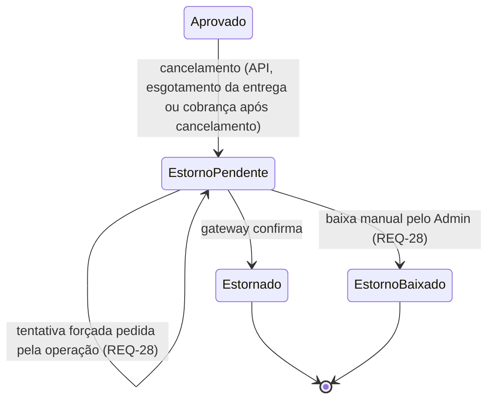
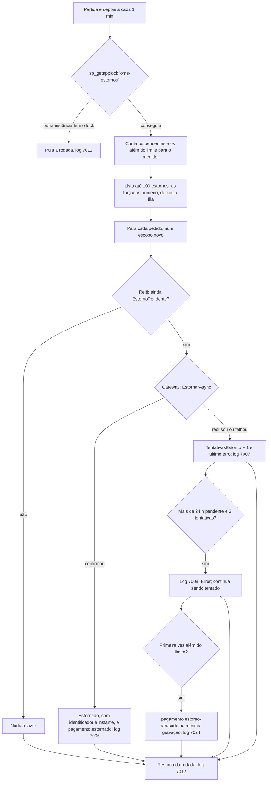

# Fluxo 10: estorno

**Onde roda**: Worker, serviço `ProcessadorEstornos`, periódico e automático. O estorno é pedido
pelo cancelamento (fluxo 3), pelo esgotamento da entrega (fluxo 9) ou pelo consumidor de
pagamento (fluxo 5).
**Origem**: REQ-13 ([spec](../../specs/013-cancelamento-com-estorno/spec.md),
[contrato](../../specs/013-cancelamento-com-estorno/contracts/estorno-e-cancelamento.md),
[research](../../specs/013-cancelamento-com-estorno/research.md)), issue #28, e REQ-15
([spec](../../specs/015-visibilidade-cancelamentos/spec.md), `pagamento.estornado`), issue #29, e
REQ-18 ([spec](../../specs/018-notificacao-status/spec.md), aviso do estorno), issue #43, e REQ-19
([spec](../../specs/019-gateway-pagamento-http/spec.md), estorno pela rede e adiamento com o
circuito aberto), issue #46, e REQ-28 ([spec](../../specs/028-acoes-estornos-pendentes/spec.md),
[contrato](../../specs/028-acoes-estornos-pendentes/contracts/estornos.md),
[research](../../specs/028-acoes-estornos-pendentes/research.md), ações da operação e evento de estorno
travado), issue #57. A chamada ao gateway está no [fluxo 14](14-gateway-de-pagamento.md).

## Para que serve

O Cliente nunca fica cobrado por um pedido cancelado. Cancelar um pedido pago deixa o estorno
**pendente** na mesma gravação do cancelamento, e o Worker pede o estorno ao gateway logo
depois, tentando de novo até conseguir.

**Por que assíncrono**: o cancelamento não pode depender do gateway. Com o gateway ou o Worker
fora do ar, a API cancela normalmente e só o estorno espera (decisão do specify do REQ-13;
princípio IV da constituição).

A operação acompanha os estornos pendentes e age sobre eles pela API (REQ-28): lista e consulta,
pede uma nova tentativa e, só o Admin, dá baixa num estorno resolvido fora do sistema. Quando um
estorno passa do limite de alerta, sai o evento `pagamento.estorno-atrasado`, uma vez.

## Situações do pagamento



As três situações são internas: não aparecem nos eventos (REQ-13, clarify). As rotas do REQ-28 têm
uma situação própria do contrato: `Pendente`, `Confirmado` e `Baixado`.

O estorno é identificado pelo `estornoId`, que hoje é o id do pagamento: há no máximo um estorno por
pagamento (REQ-28, R-01).

| Quem pede o estorno | Quando | Log 7005, origem |
|---------------------|--------|------------------|
| Cancelamento pela API | Admin ou OperadorLogistica cancela um pedido com pagamento `Aprovado` (fluxo 3) | `Operacao` |
| Reconciliação | Esgotamento da etapa de entrega (fluxo 9) | `Reconciliacao` |
| Consumidor de pagamento | O gateway aprovou a cobrança, mas o pedido foi cancelado antes da gravação (fluxo 5) | `CobrancaAposCancelamento` |

## Caminho feliz



Exemplo: a operação cancela um pedido de 149,70 em `ProntoParaEnvio`. A API responde 200, e o
Worker escreve, na rodada seguinte:

```text
info: ServicoEstornos[7006] Estorno do pedido 0199f1a2-… (valor 149.70) confirmado pelo gateway depois de 0 tentativa(s) com falha.
info: ProcessadorEstornos[7012] Rodada de estornos: 1 confirmado(s) e 0 falha(s).
```

Na mesma gravação da confirmação sai o `pagamento.estornado` (REQ-15), uma única vez por
pedido, com os identificadores do gateway, que continuam fora dos logs:

```json
{ "tipo": "pagamento.estornado", "versao": 1, "idCorrelacao": "0199f1a2-…",
  "dados": { "pedidoId": "0199f1a2-…", "numero": "PED-20261024-000001", "valor": 149.70,
             "identificadorTransacao": "PAG-0199f1a1…", "identificadorEstorno": "EST-0199f1a3…",
             "estornadoEm": "2026-10-24T15:21:00+00:00" } }
```

A cobrança aprovada para um pedido já cancelado (fluxo 5) não gera `pagamento.aprovado`: o
`pedido.cancelado` desse pedido saiu com `estornoPendente: false`, e o caso aparece só no
`pagamento.estornado`, que traz o valor e a transação da cobrança. Para conciliar dinheiro, a
fonte é o `pagamento.estornado`.

Na mesma gravação sai também o aviso `pedido.estorno-confirmado` para os webhooks e o SSE, com
o mesmo identificador do `pagamento.estornado` e só o pedido, o número e o link da consulta, sem
valores nem identificadores do gateway (REQ-18, FR-004, [fluxo 13](13-notificacao-de-status.md)).

## Ordem da fila

Primeiro os estornos com tentativa forçada pela operação, do pedido mais antigo para o mais novo
(REQ-28, índice filtrado `IX_Pagamentos_EstornoForcado`). O lote se completa com a fila de sempre:
os estornos que nunca falharam, do mais antigo para o mais novo; depois os que já falharam, o
tentado há mais tempo primeiro. Assim, um estorno que falha sempre não impede os novos de saírem
(índice filtrado `IX_Pagamentos_EstornoPendente`). Com mais forçados que o lote, o excedente fica
para a rodada seguinte, também na frente.

## Ações da operação (REQ-28)

| Rota | Perfis | Resposta |
|------|--------|----------|
| `GET /api/v1/estornos/pendentes` | Admin, OperadorLogistica | 200, página por cursor (`tamanho` de 1 a 100, padrão 20), do pedido de estorno mais antigo para o mais novo |
| `GET /api/v1/estornos/{id}` | Admin, OperadorLogistica | 200, o estorno pendente, confirmado ou baixado |
| `POST /api/v1/estornos/{id}/tentativas` | Admin, OperadorLogistica | 202, com `Location` e `tentativaForcadaEm`; a rodada faz a tentativa |
| `POST /api/v1/estornos/{id}/baixa` | Admin ativo no banco | 200, o estorno `Baixado`; o gateway não é chamado |

Cada estorno traz o pedido, o valor, quando foi pedido, as tentativas com falha, o instante e o texto
da última falha, `alemDoLimiteAlerta` (a regra do 7008), `atrasadoEm` (quando saiu o evento de
atraso), `tentativaForcadaEm` e, conforme a situação, `confirmadoEm` ou os dados da baixa (autor,
instante, motivo e referência externa). Nunca os identificadores da transação ou do estorno no
gateway. Exemplos no [contrato](../../specs/028-acoes-estornos-pendentes/contracts/estornos.md).

O último erro guarda só a categoria (R-05): `Recusado: <motivo do gateway>` (o motivo cortado em 180
caracteres), `Falha passageira do gateway.`, `Falha permanente do gateway.` ou
`Erro inesperado: <tipo da exceção>.`. A mensagem da exceção, que pode trazer endereço ou
identificadores, fica só no log 7007/7008, como antes. Estornos que falharam antes do REQ-28 mostram
o último erro vazio até a próxima falha.

Baixa:

```http
POST /api/v1/estornos/0199f1a1-…/baixa
Authorization: Bearer <token do Admin>
Content-Type: application/json

{ "motivo": "Devolvido por transferência pelo financeiro em 10/11.", "referenciaExterna": "TED-778812" }
```

Na mesma gravação saem o `pagamento.estorno-baixado` (com a referência, sem o motivo) e o aviso
`pedido.estorno-confirmado` ao Cliente ([fluxo 13](13-notificacao-de-status.md)). O
`pagamento.estornado` não sai: ele continua significando só a confirmação pelo gateway.

| Situação | Resposta | Por quê |
|----------|----------|---------|
| Sem token | 401 | Todas as rotas |
| Cliente | 403 | Todas as rotas |
| OperadorLogistica na baixa; Admin desativado ou rebaixado com o token ainda válido | 403 | A baixa encerra uma obrigação financeira sem o gateway (FR-020, Admin conferido no banco como no REQ-25) |
| Id que não é de um estorno | 404 "Estorno não encontrado." | Sem `codigo`, como os demais 404 |
| Id inválido, `tamanho` fora de 1 a 100 ou cursor adulterado | 400 com `erros.id`, `erros.tamanho` ou `erros.cursor` | Como as outras listagens |
| Motivo ausente ou fora de 10 a 500 caracteres; referência acima de 100 (sem os espaços das pontas) | 400 com `erros.motivo` ou `erros.referenciaExterna` | FR-006 |
| Baixa ou tentativa forçada de estorno confirmado ou já baixado | 409 `ESTORNO_NAO_PENDENTE` | Nada muda |
| Baixa com a rodada em andamento por mais de 5 s | 409 `ESTORNO_RODADA_EM_ANDAMENTO`, "Rodada de estornos em andamento; tente de novo em instantes."; log 7023 | Ver concorrência |
| Tentativa forçada repetida | 202 com o mesmo `tentativaForcadaEm` | FR-014: não duplica |

As rotas ficam em `/api/v1/estornos`, fora de `/admin` (que é só do Admin), e fora do limite de
requisições, que vale só para o login e o registro ([fluxo 1](01-autenticacao.md#limite-de-requisições)),
como as rotas de gestão de usuários.

## Resultados possíveis

| Situação | Resultado | Por quê |
|----------|-----------|---------|
| Gateway confirma | `Estornado`, com `IdentificadorEstorno` e `EstornadoEm` | — |
| Gateway recusa (resposta válida, negativa: `"Cobrança desconhecida."` ou `"Valor diferente do cobrado."`) | Conta como falha: continua `EstornoPendente`, log 7007 com "Recusado: …" | O dinheiro do Cliente precisa voltar; a recusa não encerra o estorno |
| Gateway sem resultado depois das tentativas da chamada (fluxo 14) | Continua `EstornoPendente`, `TentativasEstorno + 1`, log 7007 | Tenta na próxima rodada. Uma falha passageira isolada é resolvida dentro da chamada, sem contar tentativa |
| Circuito do gateway aberto (REQ-19) | **Adiado**: continua `EstornoPendente`, sem gravar nada e **sem** contar tentativa; a rodada termina ali (log 7020) | A API está fora do ar: chamá-la de novo para cada estorno não adianta, e contar tentativa anteciparia o alerta 7008 |
| Mais de `LimiteAlertaSegundos` desde o pedido de estorno **e** pelo menos `TentativasAlerta` tentativas | Log 7008 (Error) a cada nova falha; continua sendo tentado. Na primeira vez, o `pagamento.estorno-atrasado` na mesma gravação e o log 7024 | Sinal para a operação agir: pela listagem, pela tentativa forçada ou pela baixa (REQ-28); o estorno **nunca desiste** sozinho |
| Tentativa forçada pela operação | Tentada primeiro na rodada seguinte; conta como tentativa comum, e a marca sai na confirmação ou na falha. Com o circuito aberto, a marca fica e nada é contado | REQ-28, FR-011 a FR-013 |
| O estorno já não está pendente quando a rodada o relê | Nada a fazer | Outra instância já confirmou, ou o Admin deu baixa |

O evento de atraso sai uma única vez por estorno: a coluna `EstornoAtrasadoEm` só passa de nula a
preenchida, e a guarda do armazenamento exige o evento nessa gravação. Num conflito, nada é gravado, e
a próxima falha tenta de novo. Mudar a configuração do limite não o faz sair de novo. Um estorno que
já estava além do limite antes do REQ-28 gera o evento na primeira falha depois da implantação.
Sem aviso ao Cliente:

```json
{ "tipo": "pagamento.estorno-atrasado", "versao": 1, "idCorrelacao": "0199f1a2-…",
  "dados": { "estornoId": "0199f1a1-…", "pedidoId": "0199f1a2-…", "numero": "PED-20261024-000001",
             "valor": 149.70, "solicitadoEm": "2026-10-24T15:20:00+00:00", "tentativas": 3,
             "atrasadoEm": "2026-10-25T16:02:00+00:00" } }
```

## Idempotência e concorrência

| Caso | Resultado | Por quê |
|------|-----------|---------|
| Dois Workers ao mesmo tempo | Um só estorno no gateway; o outro Worker pula a rodada (log 7011) | `sp_getapplock 'oms-estornos'`, liberado com `sp_releaseapplock` no fim da rodada |
| Gateway confirma e o Worker cai antes de gravar, ou a resposta não chega | A rodada seguinte (ou a nova tentativa da mesma chamada) pede de novo e recebe **o mesmo estorno** | O pedido é a chave de idempotência do estorno (FR-013), guardada na API (REQ-19) |
| Conflito de concorrência ao gravar a confirmação | Relê e grava de novo, sem chamar o gateway, até 3 vezes; esgotadas, log 7007 sem contar tentativa, e a rodada seguinte recebe o mesmo estorno | O gateway confirmou: não é falha do estorno |
| Conflito ao gravar a falha | A tentativa não é contada; a rodada seguinte trata o pedido de novo | Nada é gravado sobre um estado antigo |
| Dois cancelamentos do mesmo pedido | Um só `EstornoPendente` (o segundo cancelamento responde 409) | Concorrência otimista no pedido |
| Baixa com a rodada em andamento | A baixa pede o mesmo lock, `sp_getapplock 'oms-estornos'`, na transação (`LockOwner = 'Transaction'`), esperando até 5 s; com o lock, relê o estorno e grava. Sem ele, 409 `ESTORNO_RODADA_EM_ANDAMENTO` e log 7023, sem gravar nada | A rodada segura o lock enquanto conversa com o gateway: a baixa não pode cair entre o pedido de estorno e a gravação do resultado, senão o dinheiro volta duas vezes (REQ-28, R-03) |
| A rodada confirma enquanto a baixa espera | A baixa relê e responde 409 `ESTORNO_NAO_PENDENTE` | O gateway já devolveu |
| A rodada começa com a baixa segurando o lock | A rodada pula (7011) e tenta no próximo intervalo; a baixa dura milissegundos | Mesmo lock, sem espera do lado do Worker |
| Duas baixas ao mesmo tempo | Uma grava; a outra espera o lock, relê e responde 409 `ESTORNO_NAO_PENDENTE` | Lock e releitura |
| Tentativa forçada ao mesmo tempo que a rodada grava uma falha | A segunda gravação dá conflito: a API relê e marca de novo (até 3 vezes); a rodada não conta a tentativa e trata o pedido na seguinte | Versão do pedido |

## Falhas externas

| Falha | Comportamento |
|-------|---------------|
| Gateway fora do ar | Os cancelamentos continuam; os estornos ficam pendentes. Enquanto o circuito não abre, cada rodada conta tentativa (7008 depois de 24 h e 3 tentativas); com o circuito aberto, a rodada adia sem contar (7020) |
| API de pagamento recriada (chaves apagadas) | O estorno de uma cobrança que a API não conhece é recusado com `"Cobrança desconhecida."` e continua pendente, com 7007 e, depois do limite, 7008 (fluxo 14) |
| Worker fora do ar | Os cancelamentos continuam pela API; os estornos esperam até o Worker voltar e saem na primeira rodada. A listagem, a consulta e a baixa funcionam (só usam a API e o banco); a tentativa forçada fica registrada e é feita na primeira rodada |
| Banco fora do ar | A rodada termina com o log 7010 e é tentada no próximo intervalo, sem derrubar o Worker. Um erro num pedido também vai para o 7010, com o id do pedido, e os demais seguem |
| Broker fora do ar | Não afeta o estorno: o `pagamento.estornado` fica pendente no outbox e sai quando o broker volta (fluxo 8) |

## Configuração (seção `Estornos`, validada na partida)

| Chave | Padrão | Faixa |
|-------|--------|-------|
| `Habilitado` | `true` | — |
| `IntervaloSegundos` | 60 | 1 a 3 600 |
| `TamanhoLote` | 100 | 1 a 1 000 |
| `LimiteAlertaSegundos` | 86 400 | 1 a 2 592 000 |
| `TentativasAlerta` | 3 | 1 a 100 |

Fora das faixas, o Worker não sobe e a mensagem cita a chave, por exemplo
"Estornos:TamanhoLote deve estar entre 1 e 1000.". Os testes de integração desligam o
processador por padrão.

A API também lê a seção, para calcular o `alemDoLimiteAlerta` da listagem com a mesma regra do 7008
(REQ-28, R-09), e também não sobe com valores fora das faixas. `LimiteAlertaSegundos` e
`TentativasAlerta` devem ser iguais nos dois processos; com valores diferentes, a listagem e o
evento de atraso discordam. A espera da baixa (5 s) é fixa.

## Observabilidade

| Log | Nível | Quando |
|-----|-------|--------|
| 7005 `EstornoSolicitado` | Information | Estorno pedido (id do pedido, valor e origem) |
| 7006 `EstornoConfirmado` | Information | Gateway confirmou (id do pedido, valor e tentativas anteriores) |
| 7007 `FalhaEstorno` | Warning | Recusa ou falha (id do pedido, tentativas e erro) |
| 7008 `EstornoPendenteAlemDoLimite` | Error | A mesma falha, depois do limite de alerta (id, tentativas e horas pendente) |
| 7009 `CobrancaAprovadaParaPedidoCancelado` | Warning | Cobrança aprovada para pedido cancelado no meio do caminho (fluxo 5) |
| 7010 `FalhaRodadaEstornos` | Warning | Falha da rodada inteira, ou erro inesperado num pedido |
| 7011 `RodadaEstornosIgnorada` | Debug | Outra instância tem o lock |
| 7012 `ResumoEstornos` | Information se tratou algo; Debug se não | Fim de cada rodada |
| 7020 `EstornosAdiados` | Warning | Rodada encerrada com o circuito do gateway aberto (quantidade adiada e até quando, REQ-19) |
| 7021 `TentativaEstornoForcada` | Information | API: tentativa forçada pedida (estorno, pedido e autor; REQ-28) |
| 7022 `EstornoBaixado` | Warning | API: baixa manual gravada (estorno, pedido, valor e autor) |
| 7023 `BaixaEstornoRecusadaRodadaEmAndamento` | Warning | API: a baixa esperou 5 s e a rodada não terminou (estorno e autor) |
| 7024 `EstornoAtrasadoPublicado` | Warning | Worker: o estorno passou do limite e o `pagamento.estorno-atrasado` saiu (estorno, pedido, tentativas e horas pendente) |

Nenhum log traz o identificador da transação ou do estorno, nem dado pessoal. Os logs da baixa não
trazem o motivo nem a referência externa.

Com a telemetria ligada (REQ-16), cada rodada que pega o lock é um trace `processar_estornos`,
e cada estorno é um passo `estornar pedido`, com `oms.pedido.id`, `oms.resultado` (`confirmado`,
`falhou`, `circuito_aberto`) e um link para o trace de criação do pedido; dentro dele, o span
`estornar pagamento` com um span HTTP por tentativa (REQ-19). A métrica `oms.rotinas.itens`
(`oms.rotina = estornos`) conta os resultados. A rodada ignorada (7011) não gera trace. O medidor
`oms.estornos.pendentes` (REQ-28) mostra os pendentes separados pelo atributo `oms.alerta`, lido no
começo de cada rodada que pega o lock.
Detalhes no [fluxo 12](12-rastreabilidade-e-metricas.md).

## Limitações

- Resolvida pela #57 (REQ-28): o estorno travado gera o `pagamento.estorno-atrasado`, uma vez, e a
  operação lista os pendentes, força uma tentativa e dá baixa pela API. Uma falha comum, abaixo do
  limite, continua sem evento.
- Se o gateway confirmou o estorno e a gravação se perdeu, e depois o Admin dá baixa, o dinheiro
  volta duas vezes (pelo gateway e por fora). O sistema não tem como saber: antes da baixa, a
  operação deve consultar o estorno no gateway.
- A baixa não pode ser desfeita pela API.
- A configuração de alerta (`LimiteAlertaSegundos` e `TentativasAlerta`) precisa ser a mesma na API e
  no Worker.
- Estorno sempre do valor total; estorno parcial e devolução de pedido despachado ficam fora do
  escopo.
- Resolvida pela #46 (REQ-19): as chaves de idempotência ficam na API de pagamento, e não se
  perdem mais quando o Worker reinicia. Recriar a própria API simulada ainda as apaga (fluxo 14).
- Pedidos cancelados com pagamento aprovado antes do REQ-13 não são estornados
  automaticamente ([quickstart, §5](../../specs/013-cancelamento-com-estorno/quickstart.md#5-pedidos-pagos-e-cancelados-antes-do-req-13)).
