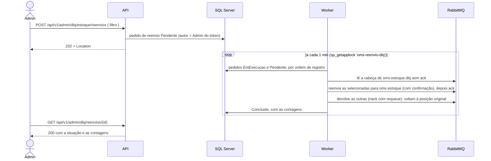

# Fluxo 11: limpeza de mensageria e reenvio da DLQ

**Onde roda**: a API registra e consulta os pedidos de reenvio (rotas de Admin); o Worker
executa os reenvios, limpa os dados antigos e confere o tamanho das DLQs.
**Origem**: REQ-14 ([spec](../../specs/014-limpeza-e-dlq/spec.md),
[contrato](../../specs/014-limpeza-e-dlq/contracts/limpeza-e-reenvio.md),
[research](../../specs/014-limpeza-e-dlq/research.md)), issue #30.

## Limpeza

O `LimpezaMensageria` roda na partida e depois a cada 1 h, com uma instância por rodada
(`sp_getapplock 'oms-limpeza'`). Ele apaga em lotes de 1 000 linhas (até 10 lotes por alvo em
cada rodada; o resto fica para a seguinte):

| Alvo | O que é apagado | Retenção padrão | Nunca apaga |
|------|-----------------|-----------------|-------------|
| `EventosSaida` | Eventos **enviados** há mais que a retenção | 7 dias | Evento pendente, de qualquer idade |
| `EventosProcessados` | Registros de processado mais antigos que a retenção | 7 dias (mínimo 24 h) | — |
| `ChavesIdempotencia` | Chaves de idempotência do REQ-05 | 48 h (mínimo 24 h) | Chave com menos de 24 h: o Cliente que repete a criação recebe o mesmo pedido |
| `PedidosReenvioDlq` | Pedidos de reenvio concluídos ou com falha | 90 dias | Pedido pendente ou em execução |

**Por que não atrapalha o resto**: o despachante só lê os pendentes, os consumidores só
inserem processados novos e a API só lê chaves recentes. Cada lote é um `DELETE TOP` curto,
pelo índice da data, sobre linhas que ninguém mais usa.

**Por que 7 dias para os processados**: as reentregas que dependem do registro chegam em
segundos ou minutos (novas tentativas e republicação do outbox). Uma mensagem da DLQ nunca foi
processada com sucesso por aquele consumidor, então o reenvio não depende do registro.

Exemplo de rodada:

```text
info: LimpezaMensageria[5013] Limpeza: 1240 evento(s) enviado(s), 1188 registro(s) de processado, 37 chave(s) de idempotência e 0 pedido(s) de reenvio apagados.
```

## Reenvio da DLQ



**Por que a API não fala com o broker**: a API está exposta à internet e só confere a
prontidão do broker, com um usuário sem permissões (`oms-api`). Quem move mensagens é o
Worker; o pedido gravado é também o histórico de quem reenviou o quê.

### Rotas (só Admin)

```http
POST /api/v1/admin/dlq/estoque/reenvios
Authorization: Bearer <token do admin>
Content-Type: application/json

{ "tipoEvento": "pedido.criado", "falhouDe": "2026-10-24T00:00:00Z", "falhouAte": "2026-10-24T23:59:59Z", "trechoMotivo": "Timeout" }
```

```http
HTTP/1.1 202 Accepted
Location: /api/v1/admin/dlq/reenvios/0199f1a2-…

{ "id": "0199f1a2-…", "consumidor": "estoque", "situacao": "Pendente", "autorId": "…",
  "tipoEvento": "pedido.criado", "trechoMotivo": "Timeout", "registradoEm": "…",
  "reenviadas": 0, "bloqueadasPeloLimite": 0, "foraDoFiltro": 0, … }
```

Todos os campos do filtro são opcionais; `{}` seleciona todas as mensagens que o limite
permitir.

| Situação | Resposta | Por quê |
|----------|----------|---------|
| Admin com filtro válido | 202, pedido `Pendente` | A rota só registra; funciona com o broker e o Worker fora |
| Consumidor fora de `estoque`, `pagamento` e `entrega` | 400 "O consumidor deve ser estoque, pagamento ou entrega." | — |
| `falhouAte` antes de `falhouDe` | 400, `erros.falhouAte`: "O fim do período deve ser igual ou posterior ao início." | — |
| `tipoEvento` com mais de 100 ou `trechoMotivo` com mais de 200 caracteres | 400, com o campo em `erros` | — |
| Sem token | 401 | — |
| Cliente ou OperadorLogistica | 403, nas duas rotas | O reenvio mexe na infraestrutura de mensageria, não num pedido |
| Consulta de pedido inexistente | 404 "Pedido de reenvio não encontrado." | — |

### O que o Worker faz com cada mensagem

| Mensagem lida da DLQ | Resultado | Contada como |
|----------------------|-----------|--------------|
| Atende ao filtro e tem menos de 3 reenvios | Vai para `oms.C` como entrega nova (cabeçalhos no [fluxo 8](08-publicacao-e-consumo-de-eventos.md#mensagem-reenviada-da-dlq-req-14)) | reenviada |
| Atende ao filtro, mas já foi reenviada 3 vezes | Fica na DLQ, na mesma posição | bloqueada pelo limite |
| Não atende ao filtro (tipo, período em que foi para a DLQ, trecho do motivo) | Fica na DLQ, na mesma posição | fora do filtro |

O filtro por período usa o `x-falhou-em`, e o por motivo usa o `x-motivo`, sem diferenciar
maiúsculas. Uma mensagem sem esses cabeçalhos não atende a um filtro que os peça. Cada pedido
lê no máximo 1 000 mensagens, e só as que já estavam na DLQ quando ele começou: uma mensagem
que ele reenviou e que falhou de novo volta para o fim da DLQ e fica para outro pedido.
As demais também ficam para outro pedido.

Uma mensagem bloqueada pelo limite continua na DLQ e entrando no aviso de tamanho; retirá-la
é manual, pelo painel (clarify).

### Garantias

| Caso | Resultado | Por quê |
|------|-----------|---------|
| Ordem das que ficam na DLQ | Preservada | O `nack` com `requeue` recoloca a mensagem na posição original (filas clássicas, como o REQ-06 declara as DLQs) |
| Broker cai no meio | O pedido fica `Falhou`, com as contagens parciais; o broker devolve sozinho as mensagens sem ack, e nenhuma se perde | O ack na DLQ só vem depois da confirmação da publicação |
| Worker cai no meio | Na rodada seguinte, o pedido `EmExecucao` é retomado sobre o que restou na DLQ | Só quem tem o lock executa |
| Broker fora antes de começar | O pedido continua `Pendente` (log 5010) e é executado quando o broker volta | O canal é aberto antes de marcar o pedido |
| Queda exata entre a confirmação e o ack | Sobra uma cópia na DLQ; se reenviada, o consumidor a descarta como duplicada | "Pelo menos uma vez" do REQ-06 |
| Dois Workers | Um executa; o outro pula a rodada (log 5015) | `sp_getapplock 'oms-reenvio-dlq'` |
| Evento já processado reenviado | Descartado como duplicado (5005), sem efeito repetido | Mesmo `MessageId` |

## Aviso da DLQ

O `MonitorDlq` confere a cada 5 min o tamanho de `oms.C.dlq` de cada consumidor e escreve o
5011 quando passa de 10 mensagens:

```text
warn: MonitorDlq[5011] A DLQ de estoque tem 23 mensagem(ns), acima do limite de 10. Investigue a causa e, se for o caso, peça o reenvio.
```

DLQ inexistente conta como zero. Broker fora: 5012, e tenta no próximo intervalo.

## Falhas externas

| Falha | Comportamento |
|-------|---------------|
| Banco fora do ar | A limpeza termina com 5014; o executor de reenvios, com 5010; os dois tentam de novo no próximo intervalo, sem derrubar o Worker |
| Broker fora do ar | A limpeza não é afetada; os pedidos de reenvio ficam pendentes; o aviso registra 5012. As rotas da API continuam funcionando |
| Worker fora do ar | Os pedidos de reenvio ficam pendentes no banco até ele voltar |

## Configuração

Seção `Limpeza` (validada na partida):

| Chave | Padrão | Faixa |
|-------|--------|-------|
| `Habilitada` | `true` | — |
| `IntervaloSegundos` | 3 600 | 60 a 86 400 |
| `TamanhoLote` | 1 000 | 1 a 10 000 |
| `LotesPorRodada` | 10 | 1 a 1 000 |
| `RetencaoEnviadosHoras` | 168 | 1 a 8 760 |
| `RetencaoProcessadosHoras` | 168 | 24 a 8 760 |
| `RetencaoChavesHoras` | 48 | 24 a 8 760 |
| `RetencaoPedidosReenvioHoras` | 2 160 | 24 a 87 600 |

Seção `ReenvioDlq`:

| Chave | Padrão | Faixa |
|-------|--------|-------|
| `Habilitado` | `true` | — |
| `IntervaloSegundos` | 60 | 1 a 3 600 |
| `MaximoReenvios` | 3 | 1 a 100 |
| `MensagensPorPedido` | 1 000 | 1 a 10 000 |
| `AvisoHabilitado` | `true` | — |
| `AvisoLimite` | 10 | 1 a 1 000 000 |
| `AvisoIntervaloSegundos` | 300 | 10 a 86 400 |

Fora das faixas, o Worker não sobe e a mensagem cita a chave, por exemplo
"Limpeza:RetencaoChavesHoras deve estar entre 24 e 8760.".

## Observabilidade

| Log | Nível | Quando |
|-----|-------|--------|
| 4006 `PedidoReenvioRegistrado` | Information | A API registrou o pedido (id, autor e consumidor) |
| 5009 `ReenvioDlqConcluido` | Information | Pedido concluído (id, autor, consumidor, filtro e contagens) |
| 5010 `ReenvioDlqFalhou` | Warning | Pedido com falha, ou deixado pendente com o broker fora |
| 5011 `DlqAcimaDoLimite` | Warning | DLQ acima do limite |
| 5012 `FalhaVerificacaoDlq` | Warning | A conferência da DLQ falhou |
| 5013 `LimpezaConcluida` | Information se apagou; Debug se não | Fim de cada rodada de limpeza, com as contagens por alvo |
| 5014 `FalhaLimpeza` | Warning | A rodada de limpeza falhou |
| 5015 `RodadaIgnorada` | Debug | Outra instância tem o lock (limpeza ou reenvio) |

O autor é o identificador do usuário, nunca o e-mail.

## Limitações

- A purga da DLQ (apagar sem reenviar) continua manual, pelo painel do RabbitMQ.
- Não há métricas nem alertas além dos logs.
- Os dados apagados pela limpeza não são arquivados.
- A garantia de ordem vale para filas clássicas; uma migração das DLQs para filas quorum
  exige rever a estratégia.
