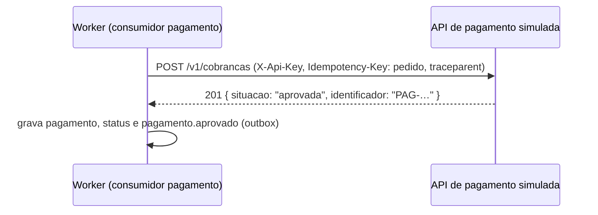

# Fluxo 14: gateway de pagamento por HTTP

**Onde roda**: Worker (consumidor `pagamento`, reconciliação e rodada de estornos), chamando a API
de pagamento simulada (`PedidoFulfillment.PagamentosSimulados`, serviço `pagamentos` do compose).
**Origem**: REQ-19 ([spec](../../specs/019-gateway-pagamento-http/spec.md),
[research](../../specs/019-gateway-pagamento-http/research.md),
[contrato da API simulada](../../specs/019-gateway-pagamento-http/contracts/api-pagamentos-simulada.md),
[contrato do cliente](../../specs/019-gateway-pagamento-http/contracts/cliente-gateway-pagamento.md)).
O que acontece com o pedido depois do resultado está nos fluxos [5](05-pagamento.md)
(cobrança), [9](09-reconciliacao.md) (reconciliação) e [10](10-estorno.md) (estorno).

O pagamento fica **fora do processo de workers**, numa API separada, chamada pela rede. Ela se
comporta como um serviço externo real: responde em tempos variados, às vezes fica indisponível,
recusa chamadas e deixa de responder. Do lado do OMS, o cliente classifica cada resposta, repete
as falhas passageiras com a mesma chave e para de chamar quando a API cai, sem nunca cobrar ou
estornar o Cliente duas vezes.

## Caminho feliz



1. O consumidor (ou a reconciliação) chama `CobrarAsync` com o pedido e o valor total.
2. O cliente HTTP envia `POST {UrlBase}/v1/cobrancas` com `{ "valor": 149.70 }`, a chave do OMS
   em `X-Api-Key` e o pedido em `Idempotency-Key`.
3. A API decide o comportamento, espera a latência sorteada, guarda a operação pela chave e
   responde `201`.
4. O OMS lê o corpo e devolve o resultado para o fluxo 5, que grava como sempre.

O estorno é igual, em `POST /v1/estornos` com `{ "identificadorCobranca": "PAG-…", "valor": 149.70 }`,
e devolve `EST-…`. A consulta (`GET /v1/cobrancas/{pedido}`) só é usada no pedido cancelado sem
pagamento (fluxo 5, FR-015).

## A API de pagamento simulada

| Rota | Credencial | Respostas |
|------|------------|-----------|
| `POST /v1/cobrancas` | `X-Api-Key` | `201` aprovada ou recusada; `200` + `Idempotent-Replayed: true` na repetição; `409` `chave-reutilizada` ou `operacao-em-andamento` (+ `Retry-After: 1`); `400`; falhas simuladas |
| `GET /v1/cobrancas/{chave}` | `X-Api-Key` | `200` com a cobrança guardada; `404` `nao-encontrada`; `409` em andamento |
| `POST /v1/estornos` | `X-Api-Key` | `201` `confirmado`, ou `recusado` com `"Cobrança desconhecida."` ou `"Valor diferente do cobrado."`; repetição como na cobrança |
| `GET /v1/estornos/{chave}` | `X-Api-Key` | Como a consulta da cobrança |
| `/controle/*` | `X-Chave-Controle` | Muda chances e latência, força ou desfaz um modo, enfileira um roteiro, restaura e mostra as operações |
| `GET /health` | nenhuma | `200` |

- **Autenticação antes de tudo**: chave ausente, errada ou de outro grupo de rotas dá `401` com o
  título `"Credencial inválida."`, igual em todos os casos, sem latência nem falha sorteada (log
  11006). As duas chaves são obrigatórias, têm 16 ou mais caracteres e são diferentes; sem isso,
  a API não sobe. A comparação é em tempo constante.
- **Idempotência pela chave** (FR-005): no máximo uma cobrança e um estorno por pedido. A mesma
  chave devolve o mesmo resultado e o mesmo identificador; com outro valor, `409`
  `chave-reutilizada`. As operações ficam **em memória**: reiniciar a API apaga as chaves.
- **Comportamentos** (FR-004): `aprovar`, `recusar`, `indisponivel` (`503`), `limite-taxa`
  (`429` + `Retry-After`), `erro-interno` (`500`), `sem-resposta` (segura a resposta por
  `SemRespostaMs` e devolve `504`, sem processar) e `processar-sem-responder` (efetiva, guarda e
  só responde depois de `SemRespostaMs`). Só aprovar, recusar e processar sem responder efetivam.
- **Decisão**: roteiro (um comportamento por chamada) → modo forçado → sorteio pelas chances. A
  decisão vem antes da memória, em toda chamada: uma falha sobre uma chave já concluída responde
  a falha e não apaga nem altera a operação guardada.
- **Latência**: a maior parte entre 40 e 250 ms, e 5% entre 1 e 5 s. A consulta sofre a latência,
  mas não as falhas sorteadas (o roteiro e o modo forçado valem para ela).
- **Padrões**: 90% de aprovação entre as que efetivam; indisponível 2%; limite de taxa,
  erro interno, sem resposta e processar sem responder 1% cada; `SemRespostaMs` 15000.
- **Modo determinístico** (`Simulacao:Deterministico`, nos testes): na partida, só aprova e sem
  latência; a rota de controle ainda define a latência e os roteiros.

Exemplo, com a chave de controle do compose:

```bash
curl -s -X POST http://localhost:5232/controle/roteiro -H "X-Chave-Controle: controle-dev-local-2026" \
  -H 'Content-Type: application/json' -d '{"comportamentos":["indisponivel","aprovar"]}'
```

## Classificação e reação

| Resposta | Classe | Repete na chamada | Conta para o circuito | O OMS |
|----------|--------|-------------------|-----------------------|-------|
| `2xx` aprovada, recusada, confirmado, recusado | resultado | não | não | Devolve o resultado; a recusa é de negócio (fluxo 5) |
| `404` na consulta | resultado | não | não | `NaoEncontrada` |
| `503`, `500`, `502`, `504` | passageira | sim | sim | Log 7013 a cada nova tentativa |
| `429` | passageira | sim, depois do `Retry-After` | sim | Log 7013 (`limite-taxa`) |
| `409` com `Retry-After` (`operacao-em-andamento`) | passageira | sim, depois do `Retry-After` | **não** (a API respondeu) | Log 7013 (`em-andamento`) |
| Falha de conexão | passageira | sim | sim | Log 7013 (`conexao`) |
| Tempo da tentativa esgotado | **incerto** | sim, com a mesma chave | sim | Log 7014; nada é gravado |
| `400`, `401`, `403`, `409` sem `Retry-After` (`chave-reutilizada`), corpo fora do contrato | permanente | não | não | Log 7015 (Error); `FalhaGatewayPagamentoException(Permanente)` |
| Tentativas ou tempo total esgotados | passageira | — | — | `FalhaGatewayPagamentoException(Passageira)` |
| Circuito aberto | — | a chamada nem sai | — | `GatewayPagamentoIndisponivelException` (pausa ou adia) |

Sem resultado, **nada é gravado** no pedido (FR-013, FR-014), e quem chamou segue o caminho de
falha de hoje: o consumidor, as novas tentativas e a DLQ da base (fluxo 8); a reconciliação, a
falha do ciclo (fluxo 9); o estorno, a falha da rodada com a tentativa contada (fluxo 10).

## Novas tentativas e tempos

O pipeline do `HttpClient` (pacote `Microsoft.Extensions.Http.Resilience`), de fora para dentro:

1. **Tempo total** da chamada: `TempoTotalMs` (10 s).
2. **Novas tentativas**: até `Tentativas` (3, contando a primeira), com espera exponencial e
   aleatória a partir de `EsperaBaseMs` (300 ms), respeitando o `Retry-After` da API.
3. **Circuito** (abaixo).
4. **Tempo por tentativa**: `TempoTentativaMs` (3 s).

Toda tentativa leva a mesma `Idempotency-Key`. A chamada roda dentro da transação do consumidor,
que até ali só leu o pedido; o tempo total limita quanto tempo a conexão fica ocupada (FR-019,
research R-10).

**Pior caso por mensagem**, com a API falhando sem abrir o circuito: 4 entregas (a original e
as 3 novas tentativas da base, com 1, 2 e 4 s de espera) de até 10 s cada, ou seja, cerca de
4 × 10 s + 7 s antes da DLQ. Numa queda de verdade, o circuito abre antes.

## Resultado incerto

A tentativa que esgota o tempo pode ter sido efetivada pela API (o caso `processar-sem-responder`).
O OMS não grava nada e repete com a mesma chave; a API devolve o resultado original com
`Idempotent-Replayed: true`:

```text
tentativa 1: POST /v1/cobrancas  → (sem resposta em 3 s)            log 7014
tentativa 2: POST /v1/cobrancas  → 200 Idempotent-Replayed: true, PAG-0199f6b1…
```

O mesmo vale para a reentrega, a reconciliação e o Worker reiniciado, porque as chaves estão na
API. Se o pedido foi cancelado antes da reentrega, o consumidor consulta a cobrança pela chave e
registra o pagamento com o estorno pendente (fluxo 5, log 7019).

## Circuito e pausa do consumo

- **Abre** com `Circuito:ProporcaoFalhas` (50%) de falhas numa janela de `Circuito:JanelaSegundos`
  (30 s), com pelo menos `Circuito:MinimoChamadas` (6) tentativas. Fica aberto por
  `Circuito:PausaSegundos` (30 s), sem chamar a API (log 7016). Depois, a próxima chamada testa
  a API (log 7017): sucesso fecha (log 7018); falha abre de novo.
- **Consumidor de pagamento**: com o circuito aberto, a mensagem volta para a fila com `nack` e
  `requeue`, sem `x-tentativas` novo e sem DLQ, e o consumo de pagamento **pausa** até a API
  poder ser testada (log 5020). A prontidão (`/health/pronto`) continua `200`. Passada a pausa, o
  supervisor reabre a inscrição (log 5021), e a primeira mensagem é a chamada de teste. Os outros
  consumidores continuam (fluxo 8).
- **Estornos**: o estorno fica `Adiado`, sem gravar e sem contar tentativa, e a rodada termina
  (log 7020). A rodada seguinte tenta de novo (fluxo 10).
- **Reconciliação**: a etapa de pagamento conta como falha do ciclo (log 9003), como com o
  gateway fora do ar (fluxo 9).

O circuito é **por instância do Worker**: com duas instâncias, cada uma decide a própria pausa.

## Quando a mensagem de pagamento ainda vai para a DLQ

A pausa cobre só o circuito aberto. Seguem as novas tentativas da base e, esgotadas, a DLQ:

- **Erro permanente** (`400`, `401`/`403`, `409` `chave-reutilizada`, corpo fora do contrato).
  Não conta para o circuito e não pausa. Exemplo: com a `ChaveApi` errada, toda mensagem de
  pagamento vai para a DLQ com o log 7015 como Error. Por decisão do usuário, credencial errada
  vai para a DLQ, e não para a pausa: pausada, ela ficaria escondida com a prontidão em `200`; na
  DLQ, o aviso do fluxo 11 alerta, e o reenvio resolve depois da correção, sem cobrança dupla.
- **Falha passageira que não abre o circuito** (intermitente abaixo da proporção, ou sem o
  mínimo de chamadas na janela), com azar em todas as entregas.
- **Falhas fora do gateway**, como antes: mensagem malformada, banco fora, conflito persistente,
  erro inesperado.

## Concorrência

| Caso | O que acontece |
|------|----------------|
| Reentrega e reconciliação do mesmo pedido ao mesmo tempo, em instâncias diferentes | As duas chamadas usam a mesma chave; a API efetiva uma vez e devolve o mesmo resultado, e a gravação segue a concorrência otimista (fluxo 5) |
| Segunda chamada enquanto a primeira está em processamento na API | `409` `operacao-em-andamento` com `Retry-After: 1`: passageira, repetida |
| Mesma chave com outro valor | `409` `chave-reutilizada`: erro permanente, sem cobrar |
| Pedido cancelado pela operação durante a chamada | A chamada termina; a gravação dá conflito e a releitura trata (fluxo 5, REQ-13 R-07) |

## Falhas externas

| Falha | Comportamento |
|-------|---------------|
| API simulada fora do ar ou lenta | Novas tentativas na chamada; numa queda, o circuito abre e o consumo pausa |
| Endereço errado ou DNS falhando | Falha de conexão: passageira |
| API reiniciada ou recriada | As chaves em memória se perdem. O OMS não cobra de novo pedido já pago (idempotência pelo estado), mas uma operação com resultado incerto naquele momento é tratada como nova. Um estorno de cobrança que a API não conhece é recusado (`"Cobrança desconhecida."`) e continua pendente (fluxo 10) |
| Worker parado no meio de uma chamada | A chamada é abandonada, nada é gravado, e a mensagem volta para a fila |

## Configuração

Worker, seção `GatewayPagamento` (validada na partida; o erro nomeia a chave sem o valor):

| Chave | Padrão | Faixa |
|-------|--------|-------|
| `UrlBase` | obrigatória | URL absoluta `http` ou `https` |
| `ChaveApi` | obrigatória | 16 ou mais caracteres; nunca aparece em log ou trace |
| `TempoTentativaMs` | 3000 | 100 a 30000 |
| `Tentativas` | 3 | 1 a 6 |
| `EsperaBaseMs` | 300 | 10 a 10000 |
| `TempoTotalMs` | 10000 | maior que `TempoTentativaMs`, até 60000 |
| `Circuito:ProporcaoFalhas` | 0.5 | 0.1 a 1.0 |
| `Circuito:MinimoChamadas` | 6 | 2 a 100 |
| `Circuito:JanelaSegundos` | 30 | 1 a 600 |
| `Circuito:PausaSegundos` | 30 | 1 a 600 |

API simulada: `Seguranca:ChaveApi`, `Seguranca:ChaveControle` e a seção `Simulacao`
([contrato](../../specs/019-gateway-pagamento-http/contracts/api-pagamentos-simulada.md#configuração)).
No compose, `OMS_PAGAMENTOS_PORTA` (5232), `OMS_PAGAMENTOS_CHAVE_API` e
`OMS_PAGAMENTOS_CHAVE_CONTROLE`; o Worker do perfil demo usa `http://pagamentos:8080`.

## Observabilidade

| Log | Nome | Nível | Quando |
|-----|------|-------|--------|
| 7013 | `FalhaPassageiraGateway` | Warning | Falha passageira, com o tipo e a tentativa |
| 7014 | `ResultadoIncertoGateway` | Warning | Tempo da tentativa esgotado |
| 7015 | `ErroPermanenteGateway` | Error | Erro permanente, com o status HTTP e o código |
| 7016 | `CircuitoAberto` | Error | Circuito aberto, com a pausa e até quando |
| 7017 | `CircuitoMeioAberto` | Information | A próxima chamada testa a API |
| 7018 | `CircuitoFechado` | Information | Chamadas normais |
| 7019 | `ConsultaCobranca` | Information | Pedido cancelado sem pagamento consultado pela chave (fluxo 5) |
| 7020 | `EstornosAdiados` | Warning | Rodada de estornos encerrada com o circuito aberto (fluxo 10) |
| 5020 | `ConsumoPausado` | Warning | Consumo pausado até a dependência voltar (fluxo 8) |
| 5021 | `ConsumoRetomado` | Information | Consumo retomado, com a duração da pausa (fluxo 8) |

Nenhum log traz a chave de acesso, o identificador de transação, o corpo ou dados pessoais. A
API simulada loga no console (11001 `OperacaoProcessada`, 11002 `FalhaSimulada`, 11003
`RepeticaoIdempotente`, 11004 `ChaveReutilizada`, 11005 `ComportamentoAlterado`, 11006
`CredencialRecusada`), com o `traceparent` recebido no escopo, e não exporta telemetria.

Traces e métricas (fluxo 12): span `cobrar pagamento`, `estornar pagamento` ou
`consultar cobranca`, com um span de cliente HTTP por tentativa (`oms.pagamento.tentativa`), e
as métricas `oms.pagamentos.chamadas`, `oms.pagamentos.duracao` e `oms.pagamentos.circuito`.

## Limitações

- As chaves da API simulada ficam em memória: recriar o contêiner `pagamentos` as apaga. Um
  gateway real as guarda de forma durável.
- O circuito é por instância do Worker; não há circuito compartilhado.
- A chamada fica dentro da transação do consumidor, limitada pelo tempo total (10 s).
- Não há gateway real, confirmação assíncrona por webhook do gateway (pagamento "em análise"),
  nova cobrança depois de uma recusa nem estorno parcial.
