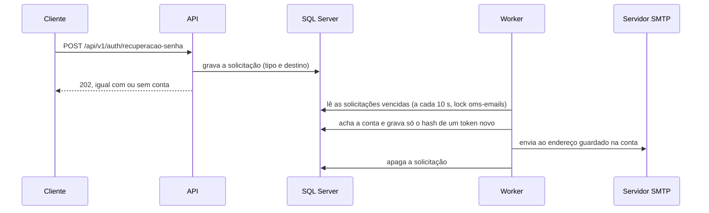

# Fluxo 16: envio de e-mail

**Onde roda**: a API e o registro gravam o pedido; o `ProcessadorEmails`, no Worker, envia.
**Origem**: REQ-24 ([spec](../../specs/024-ciclo-autenticacao/spec.md),
[research R-03 a R-05](../../specs/024-ciclo-autenticacao/research.md#r-03-envio-de-e-mail-quem-envia-e-como-o-token-fica-em-sigilo-fr-003-fr-013-fr-021),
[contrato](../../specs/024-ciclo-autenticacao/contracts/autenticacao.md)). As rotas que pedem os e-mails estão no
[fluxo 1](01-autenticacao.md).

## Caminho feliz

| Tipo | Quem pede | Token |
|------|-----------|-------|
| `RecuperacaoSenha` | `POST /recuperacao-senha` | Vale 30 minutos |
| `ConfirmacaoEmail` | O registro e `POST /confirmacao-email/reenvio` | Vale 24 horas |
| `AvisoSenhaRedefinida` | A redefinição concluída | Sem token |

- **O token em claro nunca é gravado**: existe só na memória do Worker e no e-mail. O banco guarda o SHA-256, e a
  tabela `SolicitacoesEmail` não tem token nem corpo.
- **A validade conta do envio**: um e-mail atrasado pela queda do servidor ainda chega com o prazo completo.
- **O destino é o endereço da conta**: o que foi digitado só serve para achar a conta, para um e-mail apenas equivalente
  na comparação não desviar o token.
- **Na transação de quem pediu**: o registro e a redefinição gravam a solicitação junto com a conta e com a senha nova.
- **Sem o RabbitMQ**: é uma exceção ao Princípio IV da constituição, registrada no
  [plano](../../specs/024-ciclo-autenticacao/plan.md#complexity-tracking), para não pôr no broker endereços digitados
  por qualquer pessoa. A garantia de envio vem da tabela na transação.

### Ambiente local

Como usar, com exemplos, em [E-mails no ambiente local](../emails-locais.md).

Em Development e na demonstração, o Mailpit do `docker-compose.yml` captura os e-mails, sem sair para a internet: SMTP
na porta 1025 (`OMS_MAILPIT_SMTP_PORTA`) e tela em `http://localhost:8025` (`OMS_MAILPIT_TELA_PORTA`). Os e-mails ficam só em
memória: reiniciar o contêiner apaga os anteriores.

## Erros conhecidos e tratados

| Situação | Comportamento | Exemplo | Por quê |
|----------|---------------|---------|---------|
| E-mail sem conta | Apaga a solicitação, sem enviar nem gerar token; soma `sem_conta`, sem log | Recuperação de `ninguem@exemplo.com.br` | Um e-mail sem conta fica no banco só até a rodada seguinte |
| Confirmação de conta já confirmada | Apaga, sem enviar; soma `descartado` | Reenvio depois de confirmar | FR-019 |
| Servidor recusa o destinatário com 5xx, ou endereço mal formado | Apaga, sem insistir; log 3018 | Caixa inexistente | Tentar de novo não adianta |
| Falha temporária do servidor | Reagenda com espera de 30 s, 1 min e 2 min (máximo); log 3017 | Código 4xx | A tentativa seguinte gera outro token, e só o último vale |
| Solicitação com mais de 24 h | Apaga, sem enviar; log 3018 | Servidor fora por dias | Um pedido tão antigo já não serve à pessoa |
| Queda entre o envio e a remoção | Sai um segundo e-mail, e só o token dele vale | Worker reiniciado no meio | Não duplica o efeito do token (FR-021) |
| Dois pedidos seguidos da mesma conta | Cada um gera um e-mail, e só o último token vale | Recuperação pedida duas vezes | FR-014 |
| Duas instâncias do Worker | Só a que pega o lock `oms-emails` roda a rodada | — | Evita envio duplicado |

## Falhas externas

| Falha | Comportamento | Por quê |
|-------|---------------|---------|
| Servidor SMTP fora do ar | As rotas respondem como de costume. A rodada termina na primeira falha de conexão, sem gerar um token por linha nem esperar o tempo limite 50 vezes. O e-mail chega em até 5 minutos depois da volta | SC-007 |
| Banco fora do ar | A rodada registra a falha (log 3017, só com o tipo do erro) e tenta no próximo intervalo, sem derrubar o processo | Como as demais rotinas |
| Configuração `Email` ausente ou inválida fora de Development | **O Worker não sobe**; a mensagem cita a chave, sem o valor | Uma recuperação de senha que falha em silêncio é pior que uma implantação que para na hora (FR-023) |

## Configuração

Seção `Email`, validada na partida do Worker. A API não precisa dela.

| Chave | Padrão | Regra |
|-------|:------:|-------|
| `Habilitado` | `true` | Os testes o desligam |
| `Servidor` | sem padrão | Obrigatório se habilitado |
| `Porta` | 587 | 1 a 65.535 |
| `Usuario`, `Senha` | vazios | Opcionais; a senha nunca aparece em mensagens |
| `Remetente` | sem padrão | Obrigatório se habilitado; e-mail válido |
| `Seguranca` | `StartTls` | `StartTls` ou `SslOnConnect`; `Nenhuma` só em Development e em testes |
| `UrlBaseAplicacao` | vazio | Com ela, o e-mail traz um link para a aplicação |
| `ValidadeRecuperacaoMinutos` | 30 | 5 a 1.440 |
| `ValidadeConfirmacaoHoras` | 24 | 1 a 168 |
| `TempoLimiteSegundos` | 10 | 1 a 60, por operação SMTP |
| `IntervaloSegundos` | 10 | 1 a 300 |
| `TamanhoLote` | 50 | 1 a 1.000 |

## Observabilidade

- **Log 3016** (`EmailEnviado`, Information): tipo, id da conta e e-mail mascarado. É o registro do pedido de recuperação
  que encontrou uma conta.
- **Log 3017** (`FalhaEnvioEmail`, Warning): tipo, tentativa, e-mail mascarado e o motivo.
- **Log 3018** (`EmailDescartado`, Warning): tipo, e-mail mascarado e o motivo.
- **Métrica** `oms.emails`, com `oms.email.tipo` e `oms.resultado` (`enviado`, `falha`, `descartado`, `sem_conta`).
- **Span** `processar_emails`, com `oms.rotina = emails`.
- **MailKit sem registro de protocolo**: ele poria o corpo do e-mail, com o token, no log (R-10).

Nenhum sinal traz token, corpo, e-mail completo ou endereço de origem (SC-008).

## Limitações

- **Provedor real fora do escopo**: o envio é SMTP puro, e a escolha do provedor em produção é uma decisão de implantação.
- **Sem conta, nenhum sinal por pessoa**: a métrica `sem_conta` é a única pista de pedidos para e-mails que não existem.
- **Texto simples**: os e-mails não têm HTML nem modelos configuráveis.
- **Um pedido pode invalidar um token ainda não usado**: quem pede a recuperação do e-mail de outra pessoa invalida o token
  pendente dela. O limite de 3 pedidos por hora (fluxo 1) restringe esse abuso.
