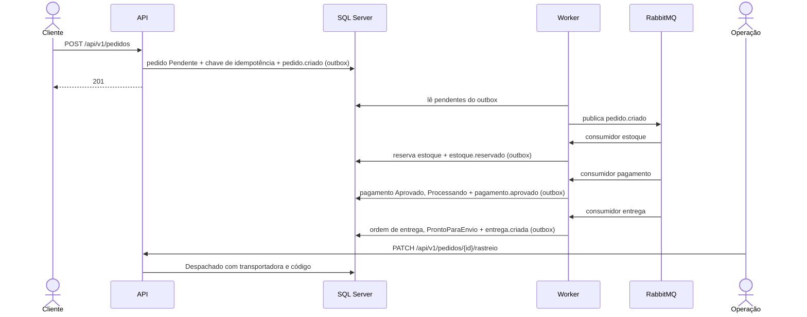
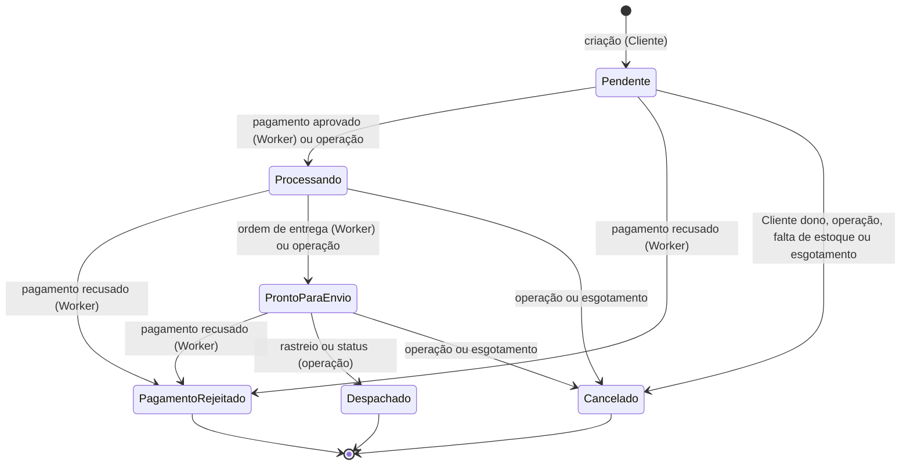

# Fluxos do sistema

Cada fluxo do OMS tem um documento com o caminho feliz, os erros conhecidos e tratados, as
falhas externas e as limitações. Cada comportamento traz um exemplo e o motivo, com o link
para a decisão de origem na spec do REQ. As specs em `specs/` continuam sendo a fonte da
verdade: estes documentos as consolidam por fluxo, de ponta a ponta.

| # | Fluxo | Onde roda | REQs |
|---|-------|-----------|------|
| 1 | [Autenticação](01-autenticacao.md) | API | 01, 03, 14 |
| 2 | [Criação de pedido](02-criacao-de-pedido.md) | API | 01, 04, 05, 16 |
| 3 | [Consulta e mudança de status](03-consulta-e-mudanca-de-status.md) | API | 05, 08, 11, 13, 15 |
| 4 | [Reserva de estoque](04-reserva-de-estoque.md) | Worker | 08, 15 |
| 5 | [Pagamento](05-pagamento.md) | Worker | 09, 13, 15 |
| 6 | [Ordem de entrega](06-ordem-de-entrega.md) | Worker | 10, 13, 15 |
| 7 | [Despacho e rastreio](07-despacho-e-rastreio.md) | API | 11 |
| 8 | [Publicação de eventos e consumo](08-publicacao-e-consumo-de-eventos.md) | Worker | 06, 12, 14, 15, 16 |
| 9 | [Reconciliação de pedidos parados](09-reconciliacao.md) | Worker | 12, 13, 15, 16 |
| 10 | [Estorno](10-estorno.md) | Worker | 13, 15, 16 |
| 11 | [Limpeza e reenvio da DLQ](11-limpeza-e-reenvio-da-dlq.md) | Worker e API (Admin) | 14, 16 |
| 12 | [Rastreabilidade e métricas](12-rastreabilidade-e-metricas.md) | API e Worker (transversal) | 16 |

## O pedido de ponta a ponta

O fluxo automático vai da criação até `ProntoParaEnvio`. O despacho é sempre feito pela
operação. A reconciliação (fluxo 9) cobre os pedidos que param no meio porque um evento se
perdeu. Quando um pedido pago é cancelado, o estorno (fluxo 10) devolve o valor ao Cliente.

Com a telemetria ligada (fluxo 12), esse caminho inteiro aparece num único trace, da rota
`POST` até o consumidor de entrega, atravessando o outbox e o RabbitMQ.

## Estados do pedido

- **Estados finais**: `Despachado`, `Cancelado` e `PagamentoRejeitado`. Nenhuma operação os
  tira daí.
- **`PagamentoRejeitado` só vem do Worker.** Pela API, ele é recusado com 400.
- **O pagamento é cobrado em qualquer status não final** com estoque reservado e sem
  pagamento. Por isso, um pedido que a operação moveu para `Processando` ou `ProntoParaEnvio`
  antes da cobrança ainda pode ir para `PagamentoRejeitado` (REQ-09, clarify).
- **Esgotamento**: cancelamento feito pela reconciliação quando a regra da etapa de estoque,
  de pagamento ou de entrega falha por mais de 24 h (fluxo 9).
- **`Cancelado` leva junto** o estoque reservado (devolvido), o pagamento aprovado (estorno
  pendente, fluxo 10) e a ordem de entrega sem despacho (cancelada), na mesma gravação
  (REQ-13), e grava o `pedido.cancelado` para outros sistemas (REQ-15, fluxo 8). O estorno
  confirmado grava o `pagamento.estornado` (fluxo 10).

## Convenções de erro da API

Toda resposta de erro é um `ProblemDetails` (RFC 7807), com `type`, `title`, `status`,
`detail`, `instance` e `traceId`. Nenhuma resposta expõe detalhes internos, como pilha,
SQL, dados de conexão ou senhas.

| Status | Quando | Corpo |
|--------|--------|-------|
| 400 | Corpo ausente ou JSON inválido, campo fora das regras, cabeçalho obrigatório ausente | `erros`: `{ "campo": ["mensagem"] }`, com o título "Um ou mais campos são inválidos." |
| 401 | Sem token, token inválido ou expirado; login recusado | Título "Não autenticado." (rotas protegidas) ou "Credenciais inválidas." (login) |
| 403 | Perfil sem permissão para a operação | Título "Acesso negado." ou a regra de negócio do Cliente |
| 404 | Pedido inexistente, ou de outro Cliente | O mesmo corpo nos dois casos, para não revelar que o pedido existe |
| 409 | Conflito de estado (transição, idempotência, duplicidade) | `codigo` estável, do [catálogo](../../specs/001-contratos-api/data-model.md#catálogo-de-códigos-de-erro) |
| 422 | Regra de negócio sobre os dados (produto inexistente ou indisponível) | `codigo` estável |
| 500 | Erro não previsto (por exemplo, banco fora do ar) | Título "Erro interno.", sem detalhes; o erro completo fica no log, com o `traceId` |

## Falhas externas, em resumo

| Dependência | Fora do ar na partida | Fora do ar durante a operação |
|-------------|-----------------------|-------------------------------|
| SQL Server (API) | Com a preparação ligada, a API não sobe e informa qual banco falhou, sem dados de conexão | 500 genérico; nada é gravado pela metade |
| SQL Server (Worker) | O Worker sobe; o despacho, o consumo e a reconciliação falham por ciclo e são tentados de novo | Despacho e reconciliação tentam no próximo ciclo; a mensagem consumida vai para as novas tentativas e, no fim, para a DLQ |
| RabbitMQ (API) | Não afeta: a API só confere a prontidão do broker, com o usuário próprio `oms-api`, sem permissões (REQ-14) | Não afeta: os eventos ficam pendentes no outbox, e os pedidos de reenvio da DLQ, pendentes no banco |
| RabbitMQ (Worker) | O Worker sobe; a prontidão (`/health/pronto`) mostra o broker e os consumidores indisponíveis; consumidores e despachante se conectam quando ele voltar | Os eventos ficam pendentes no outbox, com espera crescente até 10 s entre tentativas; os consumidores voltam sozinhos em até 1 min depois de o broker voltar, e a prontidão do Worker mostra `consumidores: Unhealthy` enquanto isso (REQ-17) |
| Gateway de pagamento | — | A cobrança falha: novas tentativas, DLQ e, se o pedido continuar parado, a reconciliação. O estorno fica pendente e é tentado a cada rodada; o cancelamento não depende do gateway |
| Destino da telemetria (REQ-16) | Não afeta: sem destino, a telemetria fica desligada | Não afeta: a exportação é em segundo plano e descarta o que não consegue enviar |

Cada documento detalha a sua parte.
