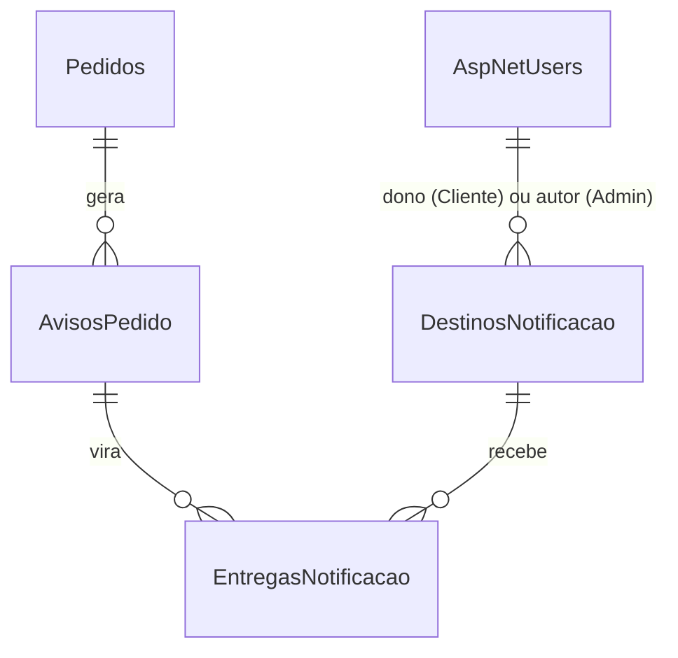
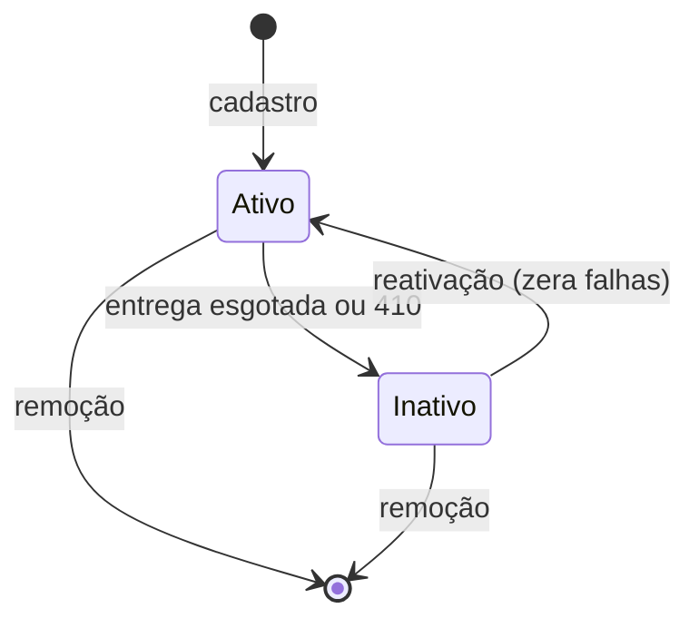
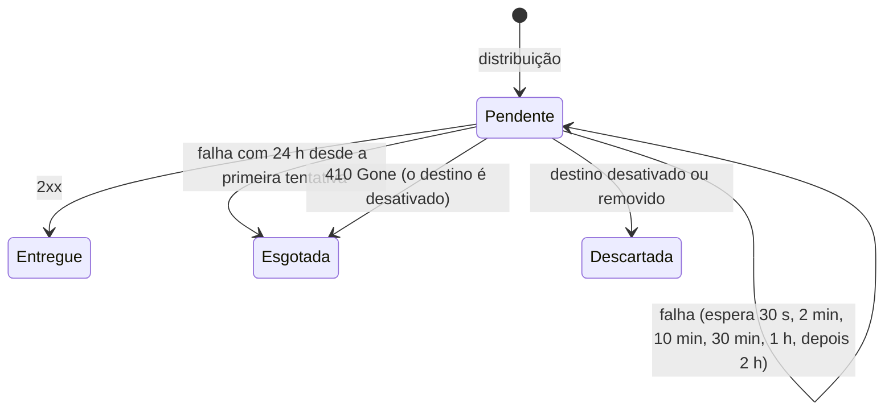

# Data Model: Notificação de mudança de status do pedido (REQ-18)

Uma migration nova, `NotificacaoStatus`, com quatro tabelas. Nenhuma coluna muda nas tabelas
existentes. Enums gravados como texto (`TamanhoEnum` = 30), com `CHECK` (`RestricoesEnum`),
como nas demais.

## `AvisoPedido` (tabela `AvisosPedido`)

Uma notificação pronta para sair, gravada na mesma transação da mudança (research R-13, R-14).
Só de inclusão. Lida pela API (SSE) e pelo Worker (webhooks).

| Campo | Tipo | Regra |
|-------|------|-------|
| `Id` | `bigint` identity | chave; referência das entregas |
| `Posicao` | `rowversion` | cursor da leitura, sempre abaixo de `MIN_ACTIVE_ROWVERSION()`; índice único |
| `IdNotificacao` | `uniqueidentifier` | único; `webhook-id`, `id` do SSE e `idNotificacao` do corpo. Igual ao `IdEvento` do `pedido.status-alterado` ou do `pagamento.estornado` de origem |
| `Tipo` | `varchar(50)` | `pedido.status-alterado` ou `pedido.estorno-confirmado` |
| `PedidoId` | `uniqueidentifier` | FK `Pedidos` |
| `ClienteId` | `uniqueidentifier` | dono do pedido, para o filtro do SSE e a escolha dos destinos; não vai no corpo |
| `Conteudo` | `nvarchar(max)` | corpo `notificacao.v1` serializado, enviado byte a byte (a assinatura é sobre ele) |
| `CriadoEm` | `datetimeoffset` | = `ocorridoEm` do corpo |
| `ContextoRastreio` | `varchar` (sombra) | contexto W3C de quem gravou (REQ-16), preenchido pelo interceptor existente |

Índices: `Posicao` (único, leitura por cursor); `(ClienteId, Posicao)` para o reenvio do SSE de
um Cliente; `CriadoEm` para a limpeza.

**Limpeza** (REQ-14): apaga avisos com mais de `RetencaoAvisosHoras` (168) que não têm entrega
`Pendente`.

## `DestinoNotificacao` (tabela `DestinosNotificacao`)

URL que recebe webhooks (FR-007 a FR-011).

| Campo | Tipo | Regra |
|-------|------|-------|
| `Id` | `uniqueidentifier` (v7) | chave |
| `ClienteId` | `uniqueidentifier?` | dono, quando é de um Cliente; **nulo = global** (da operação) |
| `CriadoPor` | `uniqueidentifier` | usuário que cadastrou (Cliente ou Admin) |
| `Url` | `nvarchar(2048)` | absoluta, `https` (fora de `PermitirRedeLocal`), sem usuário e senha, host público |
| `SegredoCifrado` | `varbinary(60)` | nonce (12) + texto cifrado (32) + tag (16), AES-GCM |
| `Ativo` | `bit` | `true` no cadastro |
| `MotivoDesativacao` | `nvarchar(200)?` | `Esgotada` (entrega X) ou `410 Gone`; nulo quando ativo |
| `DesativadoEm` | `datetimeoffset?` | |
| `FalhasSeguidas` | `int` | soma a cada falha, zera no sucesso e na reativação |
| `CriadoEm`, `AtualizadoEm` | `datetimeoffset` | `CriadoEm` limita os avisos recebidos (R-05 revista) |
| `Versao` | `rowversion` (sombra) | concorrência otimista, como em `Pedidos` |

Índices: `(ClienteId)` filtrado `ClienteId IS NOT NULL`; `(Ativo)` para a distribuição.

**Estados**

A remoção apaga a linha; as entregas pendentes viram `Descartada` antes (FK sem cascata) e as
finalizadas ficam até a limpeza, com o `DestinoId` sem FK obrigatória (`ON DELETE SET NULL`),
para a rota de entregas não quebrar no meio de uma remoção.

## `EntregaNotificacao` (tabela `EntregasNotificacao`)

O envio de um aviso para um destino (FR-012 a FR-018).

| Campo | Tipo | Regra |
|-------|------|-------|
| `Id` | `bigint` identity | chave |
| `DestinoId` | `uniqueidentifier?` | FK `DestinosNotificacao`, `SET NULL` na remoção |
| `AvisoId` | `bigint` | FK `AvisosPedido` |
| `Situacao` | `varchar(30)` | `Pendente`, `Entregue`, `Esgotada`, `Descartada` |
| `Tentativas` | `int` | |
| `ProximaTentativaEm` | `datetimeoffset` | |
| `PrimeiraTentativaEm` | `datetimeoffset?` | início da janela de 24 h |
| `UltimoCodigoHttp` | `int?` | |
| `UltimoErro` | `nvarchar(200)?` | tipo do erro (tempo esgotado, endereço recusado, conexão); sem URL completa nem corpo da resposta |
| `CriadaEm` | `datetimeoffset` | |
| `FinalizadaEm` | `datetimeoffset?` | preenchido ao sair de `Pendente`; base da limpeza |
| `ContextoRastreio` | `varchar` | copiado do aviso, para o link do span de envio |

Índices: `(DestinoId, AvisoId)` único (a distribuição repetida não duplica); `(Situacao,
ProximaTentativaEm)` filtrado `Situacao = 'Pendente'` (envio); `FinalizadaEm` filtrado não nulo
(limpeza e rota de entregas).

**Estados e espera entre tentativas**

## `CursorNotificacoes` (tabela `CursorNotificacoes`)

Uma linha (`Id` = 1) com `Posicao` (`binary(8)`): o último aviso distribuído pelo Worker. Avança
na mesma transação que cria as entregas (R-05 revista). Criada pela migration com `0x0`. A API
não usa: o cursor do SSE é em memória, por instância.

## Evento novo e corpo da notificação

- **`pedido.status-alterado` v1** (envelope do REQ-06): `pedidoId`, `numero`,
  `statusAnterior`, `statusNovo`, `sequencia`, `origem` (`Worker`, `Cliente`, `Operacao`),
  `alteradoEm`. Schema em
  [`contracts/eventos/pedido.status-alterado.v1.schema.json`](./contracts/eventos/pedido.status-alterado.v1.schema.json).
- **`notificacao` v1** (corpo do webhook e `data` do SSE): `idNotificacao`, `tipo`, `versao`,
  `ocorridoEm`, `dados` com `pedidoId`, `numero`, `link` e, para `pedido.status-alterado`,
  `statusAnterior`, `statusNovo`, `sequencia`. Schema em
  [`contracts/notificacoes/notificacao.v1.schema.json`](./contracts/notificacoes/notificacao.v1.schema.json).
  A `origem` fica só no evento: para o Cliente, saber se foi a operação basta pelo status.

## Validações (resumo)

| Regra | Onde | Resposta |
|-------|------|----------|
| URL absoluta, `https`, sem credenciais, até 2048 caracteres | validador do DTO | `400` |
| Host resolve só para endereços públicos | `ServicoDestinosNotificacao` (`EnderecosProibidos`) | `400` "O endereço do destino não é público." |
| Limite de destinos (Cliente ou globais) | serviço, sob lock por dono | `409` |
| Destino de outro dono | serviço | `404` |
| Perfil OperadorLogistica | política | `403` |
| Mais conexões SSE que o limite | `DistribuidorAvisos` | `429` |
| `pedidoId` do SSE inexistente ou de outro Cliente | serviço de consulta | `404` |
