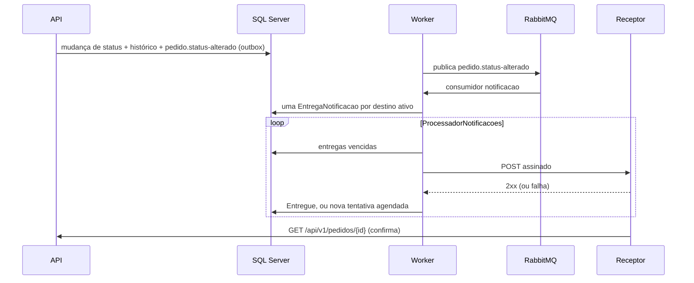

# Research: notificação de mudança de status do pedido (estudo da issue #43)

**Issue**: [#43](https://github.com/LucasFrenhan/Order-Management-System/issues/43) | **Data**: 2026-10-31 | **Situação**: proposta, aguardando aprovação

Este documento é o primeiro entregável da issue #43: a decisão fundamentada sobre como avisar
quem acompanha um pedido quando o status dele muda, com as alternativas e o custo de cada uma.
Se a decisão for aprovada, ele vira a base do `/speckit-specify` do REQ-18, e o `plan.md`
herda as decisões R-01 a R-12.

## Decisão proposta

**Webhooks para sistemas, `ETag` no `GET` como linha de base, e nada de tempo real por
enquanto**, em um REQ (REQ-18):

| Parte | Decisão | Custo |
|-------|---------|-------|
| Evento novo `pedido.status-alterado`, gravado pelo outbox em **toda** entrada nova do histórico | Adotar | Pequeno |
| Webhooks: destinos cadastrados pela API, entrega pelo Worker com assinatura, novas tentativas e desativação | Adotar | Grande |
| `ETag` / `If-None-Match` (304) no `GET /pedidos/{id}` | Adotar | Pequeno |
| SignalR ou Server-Sent Events para front-end | Adiar (não há front-end no projeto; muda a decisão do REQ-14) | — |
| Push móvel/navegador (Web Push, FCM, APNs) | Descartar | — |

O ponto que decide a forma é que **toda mudança de status já passa por um único lugar**:
`Pedido.MudarStatus` acrescenta uma entrada em `HistoricoStatusPedido`, e todas as gravações
de pedido passam por `ArmazenamentoPedidos.SalvarAsync`, que desde o REQ-15 já confere os
eventos de cancelamento e estorno (R-01). Gerar o evento ali cobre de uma vez os dois caminhos
que hoje não têm evento: o despacho com rastreio (REQ-11) e a mudança de status pela operação
(REQ-05). Os webhooks consomem esse evento como mais um consumidor da base do REQ-06, e a
entrega HTTP fica numa rotina do Worker, no molde do `ProcessadorEstornos` (R-05).

Pacotes NuGet novos: **nenhum** (R-11). Contratos: o envelope v1 ganha um tipo novo
(acréscimo, Princípio II), a API ganha rotas novas em `/api/v1/notificacoes`, e o `GET` ganha
o cabeçalho `ETag` e a resposta 304, ambos acréscimos.

## R-01 De onde saem as mudanças de status

**Levantamento** (código em 2026-10-31, `main` em `81648c7`):

| Mudança | Caminho | Onde | Evento hoje |
|---------|---------|------|-------------|
| criação → `Pendente` | API (Cliente) | `ServicoPedidos.CriarAsync` | `pedido.criado` |
| `Pendente` → `Processando` | Worker, pagamento aprovado | `Pedido.AprovarPagamento` | `pagamento.aprovado` |
| → `PagamentoRejeitado` | Worker, pagamento recusado | `Pedido.RecusarPagamento` | `pagamento.recusado` |
| `Processando` → `ProntoParaEnvio` | Worker, ordem de entrega | `Pedido.CriarOrdemEntrega` | `entrega.criada` |
| `ProntoParaEnvio` → `Despachado` | API (operação), rastreio | `Pedido.RegistrarRastreio` | **nenhum** |
| `Pendente` → `Processando`, `Processando` → `ProntoParaEnvio`, `ProntoParaEnvio` → `Despachado` | API (operação), `PATCH /status` | `ServicoPedidos.AtualizarStatusAsync` → `Pedido.MudarStatus` | **nenhum** |
| → `Cancelado` | API (Cliente ou operação), estoque, reconciliação | `Pedido.Cancelar`, `RegistrarPagamentoNaoProcessado`, `MudarStatus` | `pedido.cancelado` (REQ-15) |
| estorno confirmado (o status não muda) | Worker | `Pedido.ConfirmarEstorno` | `pagamento.estornado` (REQ-15) |
| correção do rastreio (o status não muda) | API (operação) | `Pedido.RegistrarRastreio` | nenhum |

Todos os caminhos que mudam o status chamam `Pedido.MudarStatus`, que grava a entrada do
histórico junto. É esse o gancho.

## R-02 Evento único novo, gravado na persistência

**Decisão**: um tipo novo, `pedido.status-alterado` v1, gravado pelo outbox na mesma
gravação, **um por entrada nova do histórico com status anterior** (a criação fica de fora: o
Cliente já recebeu o `201`). Quem grava é o `ArmazenamentoPedidos.SalvarAsync`, ao lado da
guarda do REQ-15: ele percorre as entradas `HistoricoStatusPedido` adicionadas e acrescenta um
`EventoSaida` para cada uma, antes do `SaveChangesAsync`.

Dados do evento (sem dados pessoais, R-09):

```json
{
  "pedidoId": "0193…",
  "numero": "PED-20261031-000123",
  "statusAnterior": "ProntoParaEnvio",
  "statusNovo": "Despachado",
  "sequencia": 5,
  "origem": "Operacao"
}
```

- `sequencia` é a posição da entrada no histórico do pedido (a criação é 1). O `rowversion` do
  pedido já impede duas mudanças concorrentes no mesmo pedido, então a sequência é única e
  crescente por pedido, sem coluna nova.
- `origem`: `Worker`, `Cliente` ou `Operacao`, pelo `AutorId` da entrada e o perfil do autor.
- O `motivo` do histórico **não** entra: é texto livre do Cliente ou da operação e pode ter
  dado pessoal.

**Motivo**: a notificação sai depois da gravação, pelo outbox, nunca dentro da rota (objetivo
3); um ponto só cobre todos os caminhos, inclusive os que forem criados depois; e o evento é
útil sozinho para sistemas de fora, que hoje não veem o despacho nem as mudanças pela API.

**Alternativas**:

- *Consumidor de notificação escutando os eventos existentes*: descartado. Faltam o despacho e
  as mudanças pela API, e cada evento tem um formato; seria preciso criar dois eventos novos de
  qualquer forma e manter um mapa de 7 tipos para status.
- *Cada caminho grava o evento explicitamente, com guarda que o exige* (o desenho do REQ-15):
  possível, mas são vários pontos de chamada (R-01) e a guarda só pega o esquecimento em tempo de
  execução. Gerar na persistência é mais curto e não depende de lembrar.
- *Interceptor do EF Core (`SaveChangesInterceptor`)*: funcionaria, mas os testes semeiam
  pedidos direto pelo contexto e ganhariam eventos que não esperam; a guarda do REQ-15 ficou
  no `ArmazenamentoPedidos` pelo mesmo motivo.

A conferir no plano: os consumidores do Worker gravam pelo `ArmazenamentoPedidos` (a base do
`ConsumidorEventos` chama o `SaveChangesAsync` do contexto para o `EventoProcessado`; o
manipulador precisa ter passado pelo `SalvarAsync` antes).

## R-03 Webhooks como canal principal

**Decisão**: o OMS chama, por `POST`, uma URL `https` cadastrada, com o corpo assinado.
Adotar.

**Motivo**: os interessados citados na issue (lojas, ERPs, parceiros) são servidores; o
webhook não exige conexão aberta na API, não acopla a API nem o Worker ao receptor (a entrega
é assíncrona, com estado no banco) e não muda a decisão do REQ-14 de a API não falar com o
broker. É também o único canal que avisa quem não está conectado no momento.

## R-04 Cadastro dos destinos

**Decisão**: entidade `DestinoNotificacao` (id, dono, URL, segredo cifrado, ativo, motivo da
desativação, falhas seguidas, criado e atualizado em), com rotas novas:

| Rota | Quem | O quê |
|------|------|-------|
| `POST /api/v1/notificacoes/destinos` | Cliente, Admin | Cadastra; devolve `201` com o segredo **uma única vez** |
| `GET /api/v1/notificacoes/destinos` | Cliente, Admin | Lista os do próprio usuário (o Admin vê também os globais) |
| `DELETE /api/v1/notificacoes/destinos/{id}` | dono | Remove; entregas pendentes são descartadas |
| `POST /api/v1/notificacoes/destinos/{id}/reativacao` | dono | Reativa um destino desativado e zera as falhas |
| `GET /api/v1/notificacoes/destinos/{id}/entregas` | dono | Últimas entregas, com situação, tentativas e último código HTTP |

- **Escopo**: o destino de um Cliente recebe só os pedidos dele; o destino de um Admin é
  global e recebe todos. O OperadorLogistica não cadastra. Destino de outro usuário responde
  404, como o pedido (fluxo 3).
- **Limite**: até 5 destinos por usuário (configurável), para não multiplicar a entrega.
- **Segredo**: 32 bytes aleatórios, gerado pelo OMS. Como o Worker precisa dele em claro para
  assinar, ele fica cifrado com AES-GCM (`System.Security.Cryptography`) e uma chave da
  configuração (`Notificacoes:ChaveCifra`), tratada como a chave do JWT. A troca do segredo é
  remover e cadastrar de novo.

**Alternativas**: só destinos globais do Admin (mais simples, mas o Cliente não integra o
próprio sistema); Data Protection do ASP.NET Core para o segredo (exige o anel de chaves
compartilhado entre API e Worker, num volume ou no banco, e o banco pede pacote novo).

## R-05 Entrega: consumidor + rotina de envio no Worker

**Decisão**, em duas etapas:

1. **Consumidor `notificacao`** (fila `oms.notificacao`, base do REQ-06, com novas tentativas e
   DLQ): recebe `pedido.status-alterado` e grava uma `EntregaNotificacao` por destino ativo
   que deve receber o pedido (globais + do Cliente dono), com índice único
   `(DestinoId, IdNotificacao)`. Não faz HTTP.
2. **`ProcessadorNotificacoes`** (rotina periódica do Worker, como o `ProcessadorEstornos`):
   pega as entregas vencidas em lote, faz o `POST` e grava o resultado.

**Motivo**: um evento vira N chamadas HTTP. Se o consumidor chamasse os destinos direto, a
falha de um faria a mensagem inteira voltar para as novas tentativas e reenviar para os que já
tinham recebido; e um receptor lento seguraria a fila. Com uma linha por destino, cada um tem
a própria tentativa, espera e desativação, e o consumidor continua rápido e idempotente.



**Regras de envio**:

| Regra | Valor proposto |
|-------|----------------|
| Sucesso | qualquer `2xx`; redirecionamento não é seguido e conta como falha |
| Tempo limite por chamada | 10 s |
| Novas tentativas | 30 s, 2 min, 10 min, 30 min, 1 h, depois a cada 2 h, até 24 h desde a primeira |
| Esgotamento | depois de 24 h, a entrega fica `Esgotada` (o equivalente da DLQ, consultável na rota de entregas) |
| Desativação do destino | ao esgotar uma entrega, ou na hora com `410 Gone`; o motivo fica gravado e um log avisa |
| Paralelismo | até 8 envios ao mesmo tempo, e um por destino, para um receptor lento não segurar os outros |
| Limpeza | entregas finalizadas saem depois de 7 dias, pela limpeza do REQ-14 |

**Alternativas**: fila por destino no RabbitMQ (topologia dinâmica, difícil de limpar e de
desativar); retry do próprio consumidor (problema do reenvio para todos, acima); Polly ou
`Microsoft.Extensions.Http.Resilience` (pacote novo para um backoff que já existe escrito no
estorno e no outbox).

## R-06 Assinatura e cabeçalhos

**Decisão**: seguir o formato do [Standard Webhooks](https://www.standardwebhooks.com/), que
tem bibliotecas prontas para o receptor em várias linguagens:

| Cabeçalho | Conteúdo |
|-----------|----------|
| `webhook-id` | `idNotificacao` (igual em todas as tentativas da mesma entrega) |
| `webhook-timestamp` | segundos Unix do envio |
| `webhook-signature` | `v1,` + Base64 de HMAC-SHA256 sobre `{id}.{timestamp}.{corpo}`, com o segredo do destino |

O receptor recusa timestamp fora de ±5 min (replay) e descarta `webhook-id` repetido. HMAC com
`System.Security.Cryptography.HMACSHA256`, sem pacote. Um teste confere a assinatura com o
segredo conhecido.

## R-07 Ordem e duplicidade

**Decisão**: entrega **pelo menos uma vez, sem garantia de ordem**. O receptor deduplica por
`webhook-id` e ignora a notificação com `sequencia` menor ou igual à última que já tratou do
mesmo pedido. A dúvida se resolve no `GET`.

**Alternativa**: segurar a sequência n+1 de um pedido até a n ser entregue (ordem por pedido).
Descartada: um receptor fora do ar travaria todas as notificações do pedido por até 24 h, e o
número de sequência já permite ao receptor descartar o que chegou atrasado.

## R-08 Proteção contra SSRF

**Decisão**, em duas camadas:

- **No cadastro**: URL absoluta, esquema `https`, sem usuário e senha na URL, porta qualquer;
  o host precisa resolver só para endereços públicos.
- **No envio**: o `SocketsHttpHandler.ConnectCallback` confere o IP resolvido antes de abrir a
  conexão (cobre a troca de DNS depois do cadastro) e recusa loopback, redes privadas
  (10/8, 172.16/12, 192.168/16), link-local (169.254/16, inclusive o endereço de metadados
  das nuvens), CGNAT (100.64/10), 0.0.0.0/8, multicast e os equivalentes IPv6 (`::1`,
  `fc00::/7`, `fe80::/10`, IPv4 mapeado).
- `Notificacoes:PermitirRedeLocal` (só aceito em Development e nos testes) libera `http` e
  loopback, para o receptor de teste e a demo local.

## R-09 Conteúdo da notificação

**Decisão**: corpo com schema versionado (`notificacao.pedido.status-alterado.v1.schema.json`)
e teste de conformidade, como os eventos v1:

```json
{
  "idNotificacao": "0193…",
  "tipo": "pedido.status-alterado",
  "versao": 1,
  "ocorridoEm": "2026-10-31T14:05:00Z",
  "dados": {
    "pedidoId": "0193…",
    "numero": "PED-20261031-000123",
    "statusAnterior": "ProntoParaEnvio",
    "statusNovo": "Despachado",
    "sequencia": 5,
    "link": "/api/v1/pedidos/0193…"
  }
}
```

Sem e-mail, endereço, itens, valores, token, dados de pagamento, transportadora nem código de
rastreio: quem quer o detalhe consulta o `GET` com o próprio token, que aplica a autorização
de sempre. `idNotificacao` é o `IdEvento` do `pedido.status-alterado`.

## R-10 Linha de base: `ETag` no `GET`

**Decisão**: o `GET /api/v1/pedidos/{id}` devolve `ETag` a partir do `rowversion` do pedido
(já existe, `ContextoBancoDados.Versao`) e responde `304` sem corpo a um `If-None-Match` igual.

**Motivo**: custo pequeno e serve a qualquer cliente que continue consultando, inclusive quem
recebeu o webhook e vai confirmar. O `rowversion` já muda em toda alteração que aparece na
resposta (o domínio mexe em `AtualizadoEm` de propósito na ordem de entrega, no rastreio e no
estorno). O 304 é acréscimo no contrato; o `oasdiff` do CI deve aceitar sem quebra, a conferir
no plano. O `Retry-After` foi descartado: o OMS não sabe quando a próxima etapa termina.

## R-11 Tempo real (SignalR, SSE) e push

**SignalR**: o servidor vem no ASP.NET Core, sem pacote. Mas a notificação nasce no Worker, e
a conexão está na API: a API teria de consumir do broker (uma fila exclusiva por instância,
ligada a `oms.eventos` com `pedido.status-alterado`, o que dispensa backplane), e o usuário
`oms-api` passaria a ter permissão de leitura, o que desfaz a decisão do REQ-14 e faz a API
depender do broker. Com Redis como backplane, seriam um pacote e um contêiner novos.
Autorização por grupo (`cliente:{id}`, `operacao`) com o JWT na query string da negociação.

**SSE**: o mesmo problema de levar o evento até a API, com um código mais simples
(`text/event-stream` nativo no .NET 10, `Last-Event-ID` = sequência). Sem o broker, a API
teria de consultar o banco de tempos em tempos, o que é o polling de antes, só que no servidor.

**Decisão**: adiar os dois. O projeto não tem front-end para usar a conexão, e o custo (API
ligada ao broker) não se paga sem ele. Se um front-end vier, a recomendação é SSE com fila
exclusiva por instância, num REQ próprio, reaproveitando o `pedido.status-alterado`.

**Push (Web Push, FCM, APNs)**: descartado. Exige serviço externo, chaves VAPID ou contas de
desenvolvedor, cadastro de dispositivos e um aplicativo que não existe.

## R-12 Observabilidade

- **Trace**: a `EntregaNotificacao` guarda o `ContextoRastreio` do evento (REQ-16), e o span de
  envio (`notificacao enviar`) é ligado a ele por link, como as rotinas do Worker. O
  `traceparent` **não** vai para o receptor, que é de fora.
- **Métricas**: `oms.notificacoes.entregas` (contador, `oms.resultado` = entregue, falha,
  esgotada), `oms.notificacoes.latencia` (histograma, do `ocorridoEm` ao `2xx`),
  `oms.notificacoes.pendentes` (gauge) e `oms.notificacoes.destinos.desativados` (gauge).
- **Logs**: faixa nova 10001 a 10010 (hoje estão em uso 3001 a 9007): destino cadastrado,
  removido, reativado, entrega criada, entregue, falhou, esgotada, destino desativado,
  endereço recusado por SSRF e resumo da rodada. A URL vai no log só com esquema e host.

## Custo estimado por abordagem

| Abordagem | Código novo | Pacotes | Infraestrutura | Testes | Operação |
|-----------|-------------|---------|----------------|--------|----------|
| Evento `pedido.status-alterado` | Pequeno: geração no `SalvarAsync`, tipo, schema | 0 | nenhuma | Unitários + integração de cada caminho do R-01 | nenhuma |
| Webhooks | Grande: 2 entidades + migration, 5 rotas, consumidor, rotina de envio, SSRF, HMAC, cifra do segredo | 0 | nenhuma (banco e broker atuais) | Grande: receptor HTTP de teste no próprio teste, falha e lentidão do receptor, assinatura, SSRF, 401/403 das rotas | Destinos desativados, entregas esgotadas, chave de cifra |
| `ETag` / 304 | Pequeno | 0 | nenhuma | Integração do 200/304 e da mudança de versão | nenhuma |
| SSE | Médio | 0 | permissões novas para o `oms-api` | Médio | API passa a depender do broker; conexões abertas por instância |
| SignalR | Médio a grande | 0 (fila por instância) ou 1 + Redis | idem, ou Redis | Médio a grande | idem, ou mais um serviço |
| Push móvel/navegador | Grande | 1 ou mais | serviço externo | Difícil de testar de verdade | chaves e contas externas |

## Perguntas para o clarify

1. O estorno confirmado deve gerar notificação, mesmo sem mudar o status? A recomendação é
   **sim**, com o consumidor `notificacao` ligado também a `pagamento.estornado` e o tipo
   `pedido.estorno-confirmado` na notificação, porque é o que o Cliente quer saber depois de um
   cancelamento.
2. A correção do rastreio (sem mudar o status) gera notificação? Recomendação: não nesta
   versão.
3. Escopo dos destinos: Cliente e Admin (proposta do R-04), ou só Admin?
4. O `ETag` entra neste REQ ou fica para outro? Recomendação: neste, como história de
   prioridade menor.
