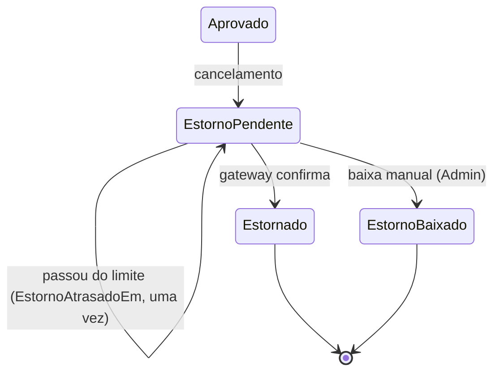

# Data model: ações da operação sobre estornos pendentes (REQ-28)

[← Plano](./plan.md)

## `Pagamentos` (tabela existente)

O estorno continua dentro do `Pagamento` ([R-01](./research.md#r-01-identificador-do-estorno-fr-001));
o `Id` do pagamento é o `estornoId` das rotas e dos eventos.

Colunas novas, todas anuláveis (nenhum dado é preenchido pela migração):

| Coluna | Tipo | Regra |
|--------|------|-------|
| `UltimoErroEstorno` | `nvarchar(200)` | Texto da última falha, só das categorias do [R-05](./research.md#r-05-último-erro-sem-dado-sensível-fr-005) |
| `TentativaEstornoForcadaEm` | `datetimeoffset` | Primeiro pedido de tentativa forçada ainda não feita; volta a nulo na confirmação ou na falha |
| `EstornoAtrasadoEm` | `datetimeoffset` | Quando o estorno passou do limite de alerta e o evento saiu; só passa de nulo a preenchido |
| `EstornoBaixadoEm` | `datetimeoffset` | Instante da baixa |
| `EstornoBaixadoPorId` | `uniqueidentifier` | Id do Admin que deu a baixa (sem chave estrangeira, como o `AutorId` do histórico) |
| `MotivoBaixaEstorno` | `nvarchar(500)` | Motivo, sem os espaços das pontas |
| `ReferenciaExternaBaixaEstorno` | `nvarchar(100)` | Referência da devolução, opcional |

Restrições:

- `CK_Pagamentos_SituacaoValida` recriada com `EstornoBaixado`.
- `CK_Pagamentos_BaixaCompleta`: `Situacao = 'EstornoBaixado'` se e só se `EstornoBaixadoEm`,
  `EstornoBaixadoPorId` e `MotivoBaixaEstorno` estão preenchidos.

Índices novos (filtrados por `[Situacao] = N'EstornoPendente'`):

- `IX_Pagamentos_EstornoForcado` (`TentativaEstornoForcadaEm`), com o filtro também em
  `TentativaEstornoForcadaEm IS NOT NULL`: primeira etapa da fila da rodada ([R-04](./research.md#r-04-tentativa-forçada-fr-011-a-fr-014)).
- `IX_Pagamentos_EstornoPendenteListagem` (`EstornoSolicitadoEm`, `Id`): ordem e cursor da listagem
  ([R-08](./research.md#r-08-listagem-fr-002-a-fr-004)).

O `IX_Pagamentos_EstornoPendente` de hoje continua para a segunda etapa da fila.

## Situações do pagamento

## Métodos do domínio

Em `Pagamento`, chamados pelo `Pedido` (como os de hoje), todos exigindo `EstornoPendente`:

| Método | Efeito |
|--------|--------|
| `PedirTentativaEstorno(instante)` | Grava `TentativaEstornoForcadaEm` se nulo; devolve se mudou |
| `RegistrarFalhaEstorno(instante, erro)` | Como hoje, mais `UltimoErroEstorno` e a marca forçada limpa |
| `MarcarEstornoAtrasado(instante)` | Grava `EstornoAtrasadoEm` se nulo; devolve se mudou (o serviço só publica quando mudou) |
| `ConfirmarEstorno(identificador, instante)` | Como hoje, mais a marca forçada limpa |
| `DarBaixaEstorno(autorId, motivo, referencia, instante)` | `EstornoBaixado`, com os quatro campos e a marca limpa |

Fora de `EstornoPendente`, cada um lança `InvalidOperationException`; o serviço de aplicação confere a
situação antes e responde 409 `ESTORNO_NAO_PENDENTE`.

## Eventos novos (outbox)

| Tipo | Versão | Quando | Schema |
|------|--------|--------|--------|
| `pagamento.estorno-atrasado` | 1 | Falha que leva o estorno além do limite, uma vez | [schema](./contracts/eventos/pagamento.estorno-atrasado.v1.schema.json) |
| `pagamento.estorno-baixado` | 1 | Baixa manual | [schema](./contracts/eventos/pagamento.estorno-baixado.v1.schema.json) |

O `idCorrelacao` do envelope é o id do pedido, como nos eventos de pagamento de hoje. A guarda do
`ArmazenamentoPedidos` passa a exigir cada evento na transição correspondente
([R-06](./research.md#r-06-evento-de-estorno-travado-uma-única-vez-fr-015-a-fr-018),
[R-07](./research.md#r-07-evento-da-baixa-e-aviso-ao-cliente-fr-010-fr-010a)).

## Aviso ao Cliente

A baixa gera um `AvisoPedido` `pedido.estorno-confirmado`, com o id do `pagamento.estorno-baixado`
como id da notificação; o conteúdo é o mesmo da confirmação pelo gateway.

## Configuração

Sem chave nova. A API passa a ler `Estornos:LimiteAlertaSegundos` e `Estornos:TentativasAlerta`, com
os mesmos padrões e faixas do Worker ([R-09](./research.md#r-09-alerta-na-listagem-fr-002-us1-cenário-3)).
A espera da baixa (5 s) é constante, decidida no clarify.
